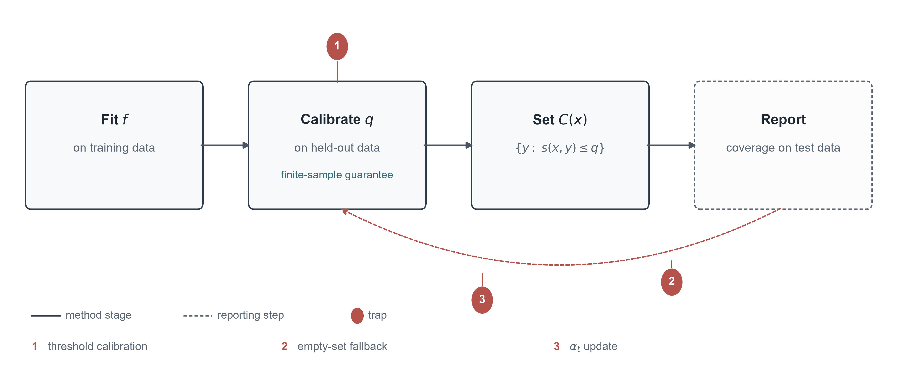
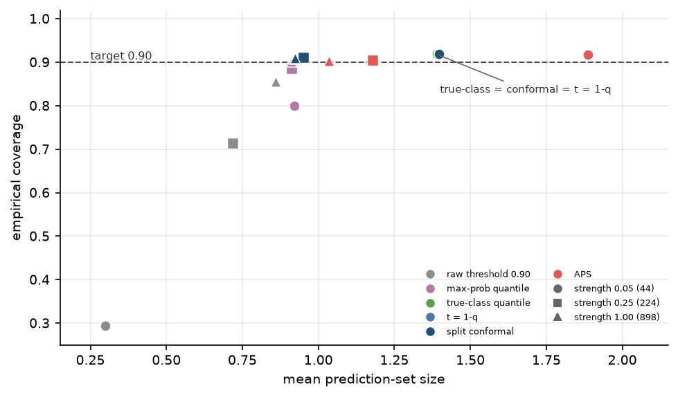
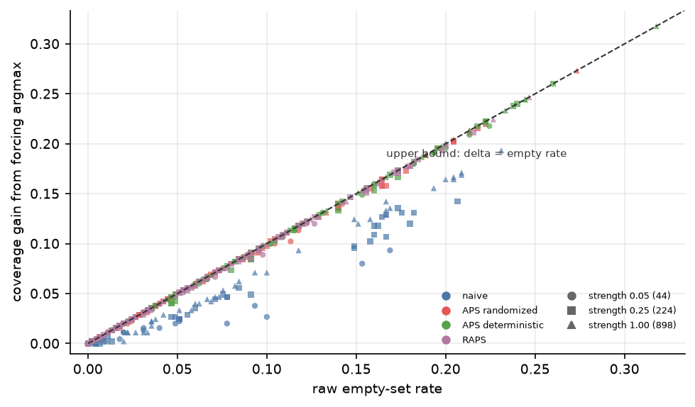
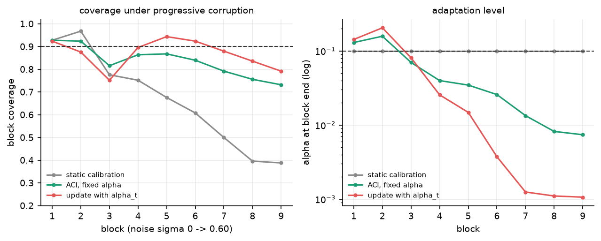

# When Reported Coverage Is Not Coverage: A Controlled Audit of Conformal Prediction Implementations

::: {.author}
Shaoxuan Zhang

Faculty of Computing, Harbin Institute of Technology, Harbin, Heilongjiang, China

ORCID: 0009-0001-4103-6099

Corresponding author: 2023113033@stu.hit.edu.cn
:::

**Abstract.** A conformal predictor carries a finite-sample coverage guarantee, but the number a pipeline reports comes from the implementation and can depart from it. This note presents an audit protocol for three choices between the guarantee and the reported figure: threshold calibration, the treatment of empty sets, and the update rule of adaptive conformal inference. The protocol combines existing constructions with an exact coverage accounting identity and a cost rule for the empty-set fallback. Applied to digits, CIFAR-10, covertype and eight public implementations, it produces a consistent picture. A fixed probability threshold yields a set with no coverage guarantee, and its reported figure describes accuracy among non-abstentions; a true-class threshold coincides exactly with split conformal. Forcing the argmax into empty sets raises reported coverage by up to 9.7 points on the image benchmarks, with little effect on a tabular benchmark whose empty rate is near zero. The common alpha_t recursion omits the fixed target and reports higher coverage by inflating the sets; three of the eight libraries use the correct fixed-target update.

**Keywords.** conformal prediction; coverage; calibration; post-processing; adaptive conformal inference; implementation audit.

## 1. Introduction

### 1.1 The data challenge

A practitioner who wants 0.90 coverage can threshold the softmax at 0.90, retain the labels above the threshold, and report the fraction of test points whose true label survives. The resulting figure usually tracks the model's accuracy, and it is often read as evidence that the pipeline is calibrated. The threshold, however, is a fixed probability with no quantile attached to it, and the set it produces may contain one label or none. What the figure describes is the behaviour of that threshold rule on the test sample; the coverage guarantee belongs to a different construction.

The conformal alternative replaces the fixed threshold with a quantile of calibration scores, and the resulting set satisfies a finite-sample guarantee under exchangeability [@Vovk2005; @Angelopoulos2021intro]. That guarantee concerns the procedure, while the number printed by a particular pipeline is a separate object, and three implementation choices can move it without touching the guarantee. One is how the threshold is calibrated. Another is what the code does when a set is empty. A third is how an adaptive method updates its target. A deployment that compares methods, or that decides whether to abstain, therefore faces a practical question: whether the printed figure reflects the guarantee or merely the implementation.

### 1.2 Relevant data

We study the challenge on three public datasets chosen for different failure surfaces. Digits is small enough for hand checks, CIFAR-10 supplies tight coverage estimates at scale, and covertype tests whether the mechanism survives a change of modality. The grid varies score, target level, calibration size and model strength, and every cell is evaluated twice, once with empty sets retained and once with the argmax forced. It contains 1,260 image cells, with a 180-row tabular replication, and eight public implementations are run on a common synthetic task. The data, code and every table are available at https://github.com/ZhangShaoXuan-HIT/conformal-audit and archived at https://doi.org/10.5281/zenodo.24001054.

### 1.3 Approach and contributions

The approach is an audit protocol assembled from existing conformal constructions. It introduces no new estimator and no new score; what it changes is the object of study. One probe asks which threshold is calibrated, a second asks what the implementation does with an empty set, and a third asks whether an adaptive method updates a fixed target or its own current level. The protocol reports coverage, set size, empty rate, the conditional accuracy of the inserted label, and the cost ratio at which the fallback is optimal. Because the output includes a decision rule, the audit is useful beyond a comparison of point estimates.

The paper contributes the protocol itself, an empirical audit on three datasets and 1,260 image cells, a policy map of eight implementations, and the cost rule. The map records which libraries force a non-empty set by default, which expose randomization, and which return the raw set; the cost rule converts the fallback into a comparison between the loss of abstaining and the loss of a wrong answer. The audit sits alongside four surveys and tutorials [@Angelopoulos2021intro; @Fontana2023; @Campos2024; @Zhou2025] and the closest 2025-2026 work [@Aguru2026; @Mehrtens2025; @Gauthier2025; @Bataineh2026; @Boman2026]. The threshold identity has appeared before; the contribution here is the measurement of what follows when a pipeline uses the wrong threshold, the wrong post-processing, or the wrong update.

## 2. Methodology/Approach

### 2.1 The audit protocol

A conformal pipeline fits a model f, calibrates a quantile q on held-out data, and forms C(x) = {y : s(x,y) <= q}. Each stage admits a plausible shortcut, and the protocol turns each shortcut into a probe.

The threshold probe compares four rules: a raw 0.90 threshold, a quantile of the maximum probability, a quantile of the true-class probability, and split conformal with the naive score. The raw rule returns a singleton or an empty set; the maximum-probability rule takes a quantile of a quantity unrelated to the calibration score. For the naive score s(x,y) = 1 - p_y, the true-class threshold t satisfies p_y >= 1 - q, which is exactly the conformal set. We check the identity pointwise as well as in aggregate coverage, since a coverage match can hide set-level disagreement.

The empty-set probe keeps the raw set and a forced set in which the argmax is inserted only when the raw set is empty. If e is the empty rate and a_E is the fraction of empty-set points on which the argmax is correct, forcing adds one covered point for each such point, so the coverage gain is exactly delta = e a_E. The identity is exact and yields a cost rule: with c_a the loss of abstaining and c_e the loss of a wrong answer, forcing is preferable when c_e (1 - a_E) < c_a, or c_a / c_e > 1 - a_E. The audit estimates a_E as delta / e.

The update probe compares the published recursion alpha_{t+1} = alpha_t + gamma (alpha - err_t) with a common variant that replaces the fixed target by the current level, alpha_{t+1} = alpha_t + gamma (alpha_t - err_t). The fixed target supplies the restoring force; the variant removes it and adds a positive feedback term. We run the static procedure, the correct recursion and the variant on controlled streams, and record coverage, set size, the share of near-trivial sets with at least nine of the ten labels, and the final level.

Figure 1 shows the pipeline and the three probes, which work with existing scores and estimators; the protocol's contribution is to treat the implementation as the object of study and to decompose the reported number into the quantities that produce it.

The dashed reporting step is where the three probes act; each probe holds the other two stages fixed.

### 2.2 Data and experimental grid

Digits contains 1,797 images of 8 by 8 pixels in ten classes. A stratified split holds out 450 test points and 898 training points, with the calibration set drawn from the remaining 449; the model is a standardiser followed by multinomial logistic regression, and the training set is subsampled to 5, 25 and 100 percent (44, 224 and 898 points). CIFAR-10 contributes 50,000 training and 10,000 test images; a pretrained ResNet-18 supplies 512-dimensional features, a logistic-regression head is fitted on 100, 1,000, 5,000 or 30,000 images, and the calibration set is drawn from the remaining 20,000 at sizes 500, 2,000 and 10,000. Covertype is a 581,012-row, 54-feature, seven-class tabular dataset; we use a 120,000-row stratified subset, a logistic regression, training sizes of 6,000 and 60,000, a calibration set of 20,000 and a test set of 40,000.

Four scores enter the grid: the naive score 1 - p_y, randomized APS, deterministic APS and RAPS. The grid crosses score, target level (0.05, 0.10, 0.20), calibration size and model strength. Audit A fixes alpha = 0.10 and compares the four threshold rules; Audit B runs the full score-by-level-by-calibration-by-strength grid, 540 digits cells and 720 CIFAR-10 cells, each evaluated raw and forced; Audit C uses controlled drift streams, with 450 digits points in nine blocks and Gaussian noise rising from 0 to 0.60, and 3,000 CIFAR-10 images in three severity blocks across five corruption types. Five seeds are used for Audits A and B, and three for the CIFAR-10 drift stream.

The grid also serves as the simulation study, varying the factors a deployment can control and includes regimes where the effect should be large and regimes where it should vanish. The tabular replication acts as a stress test, since it changes modality, model and empty rate at once.

### 2.3 Implementations

We inspect eight implementations: MAPIE 1.6.0, TorchCP 1.2.1, puncc 0.9.3, crepes 0.9.1, coverforest 0.0.3, nonconformist 2.1.0, conformal 0.1 and the AdaptiveConformal R package. All eight were read at source level. Five were run on a common synthetic five-class task, with five seeds for MAPIE and one for the others; TorchCP, coverforest and AdaptiveConformal were read only. The sample deliberately includes two older, smaller packages and covers eight public implementations; a complete census remains future work.

### 2.4 Metrics and the cost rule

For each cell we record coverage, mean set size, the raw empty rate, the share of near-trivial sets, class coverage, expected calibration error and negative log-likelihood. Each raw/forced pair contributes delta = coverage_forced - coverage_raw and a_E = delta / e. The cost rule compares c_a / c_e with 1 - a_E; a deployment that reports both quantities can apply it, while one that reports coverage alone cannot.

## 3. Application of the Methodology

### 3.1 Threshold calibration

On digits with 44 training points, the raw 0.90 threshold returns an empty set for 70.1 percent of the test points and covers 0.294; forcing the argmax lifts coverage to 0.833, which equals the model's accuracy. The maximum-probability rule reaches 0.668, while the true-class rule reaches 0.800 with no empty sets. At 898 training points the raw threshold covers 0.855 with 14.0 percent empty, the maximum-probability rule reaches 0.771, and the true-class rule reaches 0.901. With a calibration set of 449, the true-class rule and split conformal coincide at 0.919, and the pointwise comparison shows zero mismatches over 450 test points, five seeds and three strengths.

On CIFAR-10 with 30,000 training images, the raw threshold returns an empty set for 24.4 percent of the test points even though the model is 85.5 percent accurate; coverage is 0.716, and forcing the argmax raises it to 0.855. The maximum-probability rule reaches 0.810 at a target of 0.90, and the true-class rule agrees with split conformal pointwise over 10,000 test points, five seeds and four strengths.

Table 1 sets the four rules side by side at two training sizes. The gap between the raw and true-class columns is widest when the model is weak and narrows as training grows, while the maximum-probability column never closes it.

### Table 1. Threshold calibration

| dataset | training | rule | coverage | empty |
|---|---|---|---|---|
| digits | 44 | raw 0.90 | 0.294 | 0.701 |
| digits | 44 | max-probability | 0.668 | 0.086 |
| digits | 44 | true-class | 0.800 | 0.000 |
| digits | 898 | raw 0.90 | 0.855 | 0.140 |
| digits | 898 | max-probability | 0.771 | 0.008 |
| digits | 898 | true-class | 0.901 | 0.000 |
| CIFAR-10 | 30,000 | raw 0.90 | 0.716 | 0.244 |
| CIFAR-10 | 30,000 | max-probability | 0.810 | 0.000 |
| CIFAR-10 | 30,000 | true-class | 0.899 | 0.000 |

The true-class rule and split conformal are identical pointwise. The raw threshold is a singleton or empty; its coverage is accuracy on non-abstentions.

The table isolates the source of the gap. A raw threshold at 0.90 is a fixed probability, and its coverage column is accuracy among the points it did not abstain on; the true-class column is the only one that matches split conformal at every training size.

Figure 2 recasts the same cells as a coverage-size plot. The raw threshold sits at the bottom left, the maximum-probability rule moves up but stays below the target, and the true-class rule lies on the diagonal.

The vertical distance from the target is the coverage cost of the wrong quantile; the horizontal distance is the set-size cost.

### 3.2 Empty-set post-processing

Across the 540 digits cells, forcing raises coverage by 0.077 on average and by as much as 0.318. The mean gain is 0.041 for the naive score, 0.080 for randomized APS, 0.108 for deterministic APS and 0.078 for RAPS, a ranking that follows the empty rates: the naive score rarely leaves a set empty, while deterministic APS does so often. On CIFAR-10 the naive score produces no empty sets at any strength; randomized APS produces 1.0 to 3.7 percent empty sets and shifts coverage by 0.9 to 3.6 points, and deterministic APS produces 6.9 to 9.5 percent empty sets and shifts coverage by 6.8 to 9.5 points. The 5,000-image APS cell is the exception, since it is already conservative at 0.994 coverage and a mean size of 6.08, leaving the fallback with nothing to do.

The accounting identity explains the pattern: the gain equals the empty rate multiplied by the conditional accuracy of the argmax on empty sets. That accuracy is high, between 0.94 and 0.99, because the model is usually correct even when the set is empty, so the empty rate governs the size of the effect. On covertype the mean empty rate is 0.3 percent and the gain is 0.0 to 0.4 points, which makes the same post-processing nearly invisible.

The library audit reproduces the mechanism in released code. MAPIE's APS default inserts the last label that crosses the quantile and therefore never returns an empty set; over five seeds it reaches 0.9457 with zero empty sets, against 0.8998 for the randomized rule, a 4.6-point gap. puncc's APS reaches 0.977 with randomization off and 0.889 with it on. The LAC implementations of MAPIE, puncc and crepes agree to three decimals at 0.895 and a mean size of 2.87, which serves as a consistency check, and nonconformist and conformal also return no empty sets on the common task.

Table 2 turns from the grid to the libraries. Each row records what one implementation does with an empty set: MAPIE's default and puncc with randomization off never return one, while the LAC rows do.

### Table 2. Library behaviour

| implementation | setting | coverage | empty | size |
|---|---|---|---|---|
| MAPIE | APS default | 0.9457 | 0.0000 | 3.68 |
| MAPIE | APS randomized | 0.8998 | 0.0004 | 3.23 |
| puncc | APS randomization off | 0.977 | 0.000 | 4.06 |
| puncc | APS randomization on | 0.889 | 0.002 | 2.98 |
| crepes | LAC | 0.895 | 0.000 | 2.87 |
| nonconformist | ICP margin | 0.890 | 0.000 | 3.50 |
| conformal | per-label thresholds | 0.890 | 0.000 | 3.02 |

MAPIE rows are five seeds; the other rows are one seed on the common synthetic task. The LAC implementations of MAPIE, puncc and crepes agree at 0.895 and a size of 2.87.

The table separates the libraries by policy. MAPIE and puncc sit at the top of the coverage column because they insert a label; crepes, nonconformist and conformal sit near 0.89 because they return the raw set.

Figure 3 shows the same mechanism across the full image grid. The gain from forcing is a line through the origin with slope equal to the conditional accuracy of the argmax; points below the line are cells where the argmax is less accurate on empty sets.

The cluster near the origin is the low-empty-rate regime, where the policy barely matters; the spread at higher rates is where it changes the reported number.

### 3.3 Adaptive conformal inference

On digits, the static procedure covers 0.666 of the stream. The correct update at gamma = 0.02 covers 0.836 with a mean size of 3.44, while the incorrect update covers 0.869 with a mean size of 4.58. The extra 3.3 points of coverage come with a 33 percent increase in size and a rise in the near-trivial share from 10.8 to 24.4 percent. The final level is 0.0074 for the correct rule and 0.0011 for the incorrect one, at the lower clip. At gamma = 0.1, two of the five digits seeds drive the level above 0.69, one of them to 0.998, and coverage falls to 0.436 and 0.162.

On CIFAR-10 with five corruption types and three severities, the static procedure covers 0.451; the correct update covers 0.828 with a mean size of 4.93, and the incorrect update covers 0.936 with a mean size of 6.97. The gain is 10.8 points, the size cost is 41 percent, and the near-trivial share rises from 14.5 to 38.0 percent. Block coverage under the correct rule is 0.853, 0.829 and 0.802 at the three severities, and under the incorrect rule it is 0.940, 0.939 and 0.928. The correct rule falls short of 0.90, while the incorrect rule exceeds it by inflating the sets.

Table 3 sets the three updates side by side. The incorrect variant buys 3.3 points on digits and 10.8 on CIFAR-10, and pays for them with 33 and 41 percent more set size.

### Table 3. ACI update

| dataset | update | coverage | size | near-trivial | alpha final |
|---|---|---|---|---|---|
| digits | static | 0.666 | — | — | — |
| digits | correct | 0.836 | 3.44 | 0.108 | 0.0074 |
| digits | incorrect | 0.869 | 4.58 | 0.244 | 0.0011 |
| CIFAR-10 | static | 0.451 | 1.30 | 0.000 | — |
| CIFAR-10 | correct | 0.828 | 4.93 | 0.145 | 0.0106 |
| CIFAR-10 | incorrect | 0.936 | 6.97 | 0.380 | 0.0019 |

The incorrect update reports more coverage at a larger size and a larger near-trivial share. The correct update also falls short of 0.90.

The table makes the trade-off explicit. The extra coverage in the incorrect row comes with a larger set and a larger near-trivial share, and the final level sits at the lower clip; the correct row misses the target, but its level stays away from the clip. Three of the eight implementations (MAPIE, TorchCP and AdaptiveConformal) use the correct fixed-target update; the others do not implement ACI. The correct rule also misses 0.90 on these streams; the shortfall follows from finite-time behaviour and limited calibration support.

### 3.4 The cost rule

The audit also yields the quantity a deployment needs: on digits the mean a_E is 0.99, so the cost threshold c_a / c_e is 0.01; on CIFAR-10 it lies between 0.96 and 0.99, giving a threshold of 0.01 to 0.04; on covertype it is 0.94, giving 0.06. Forcing is preferable to abstaining unless abstaining costs less than one to six percent of an error. The defaults are therefore rational for most deployments, although the decision is usually made silently, and the reported coverage no longer estimates the nominal level once the fallback is active.

Table 4 reduces the cost calculation to a single ratio. The mean a_E is 0.99 on digits, 0.96 to 0.99 on CIFAR-10 and 0.94 on covertype, so the threshold c_a / c_e lies between 0.01 and 0.06.

### Table 4. Cost rule

| dataset | mean a_E | threshold c_a / c_e |
|---|---|---|
| digits | 0.99 | 0.01 |
| CIFAR-10 | 0.96 to 0.99 | 0.01 to 0.04 |
| covertype | 0.94 | 0.06 |

Forcing is better than abstaining when c_a / c_e exceeds 1 - a_E. The threshold is small in every dataset; the empty rate determines the exposure.

The table condenses the decision into one ratio. The per-point proxy, which uses the maximum probability for a_E, coincides with uniform forcing at or above 0.05 on all three datasets, so it adds nothing to the population rule.

Figure 4 returns to the update results and shows the trajectories behind Table 3. The correct rule recovers after each block; the incorrect rule drifts upward and never returns.

The divergence persists across blocks and reflects the fixed point of the variant.

### 3.5 Simulation and the boundary

The 1,260 image cells form the simulation component: the data are held fixed while score, target level, calibration size and model strength vary. The effect does not track model strength in a simple way, since a stronger model can have a higher empty rate when the score is more likely to cross the threshold on every label. Across the grid, the ranking of scores follows the ranking of empty rates, and the forced evaluation can reverse the ranking of two methods that differ only in their post-processing.

The covertype replication marks the boundary: at alpha = 0.10 the empty rate is 0.0 to 0.4 percent and the forcing gain is 0.0 to 0.4 points, so the identity still holds but has almost nothing to multiply. This is the behaviour the protocol predicts: a large gain on images and a near-zero gain on a well-calibrated tabular model are consistent with each other, and together they locate the exposure.

## 4. Conclusion and Discussion

The guarantee applies to the procedure, while the printed number is produced by the implementation. The audit separates that number into three choices, and each choice leaves a different signature. The threshold probe shows that a fixed probability threshold produces a set with no coverage guarantee, and that the true-class threshold coincides with split conformal. The empty-set probe shows that reported coverage can rise by several points without any change to the score, with the gain equal to the empty rate times the conditional accuracy of the inserted label. The update probe shows that the common alpha_t recursion omits the fixed target and can report higher coverage by inflating sets. The library audit confirms that these patterns appear in released code: a widely used default over-covers by 4.6 points, and a second library's randomization switch changes coverage by 8.8 points.

A practical recommendation follows from these results: report raw and forced coverage, the empty rate, the conditional accuracy of the inserted label and the set size, together with the cost ratio at which the fallback is optimal. The non-empty rule should be an explicit option, and the default should be the exact rule that carries the guarantee. Without the empty rate and the cost ratio, a reported coverage figure cannot be checked.

The audit design imposes limits: three datasets, linear heads on small images and a tabular benchmark, and synthetic drift on digits plus a corruption family on CIFAR-10 restrict the scope; the library sample covers eight implementations, and a complete census remains future work. The audit does not prove a theorem about finite-time ACI, and the covertype boundary shows that the magnitude depends on the regime. These limits qualify the numbers, although the protocol is designed to travel to other datasets.

Three extensions would strengthen the work: a larger library census would show how representative the eight implementations are; a theoretical bound on the finite-time gap of ACI would explain the shortfall observed on the drift streams; and a deployment study with real costs would test the cost rule outside the benchmark. Each depends on the same precondition: the reported number has to be visible enough to study, which is what the audit provides.

## Acknowledgments

The author thanks the maintainers of the audited libraries for public code and documentation.

## Declaration of interest

The author reports no competing interests to declare.

## Funding

This research received no specific grant from any funding agency.

## Declaration of generative AI use

The author used a generative AI assistant (DeepSeek) for code development, data analysis, and drafting/editing of the manuscript. The author verified all results, analyses, and references and takes full responsibility for the content.

## CRediT authorship contribution statement

Shaoxuan Zhang: Conceptualization, Methodology, Software, Validation, Formal analysis, Investigation, Data curation, Writing - original draft, Writing - review & editing, Visualization.

## Data availability statement

The code, results and tables are available at https://github.com/ZhangShaoXuan-HIT/conformal-audit and archived at https://doi.org/10.5281/zenodo.24001054.

## Supplementary material

The supplementary file contains the full tables, the two-axis map, the complete experimental grid, the per-corruption results and the checklist. The main text reports the cells needed for the argument.

## References

<!-- REFERENCES -->
