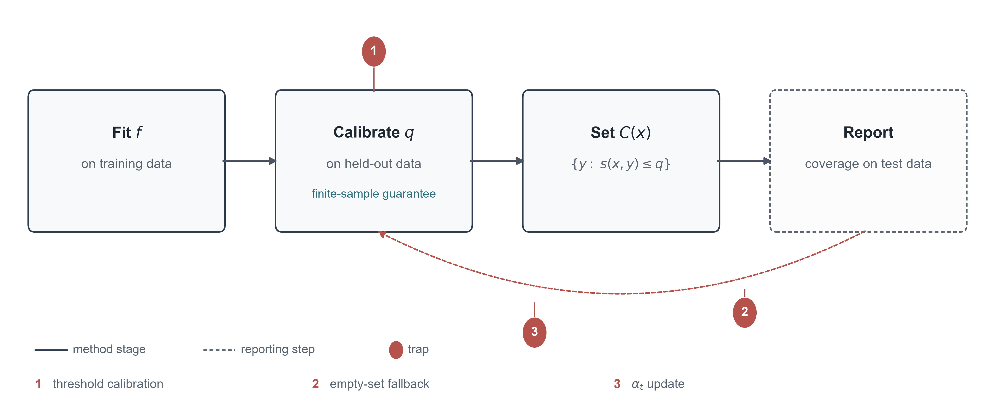
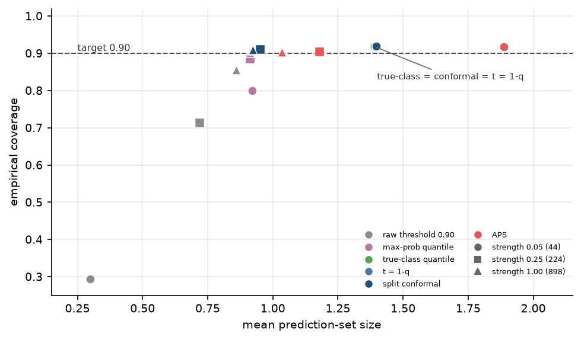
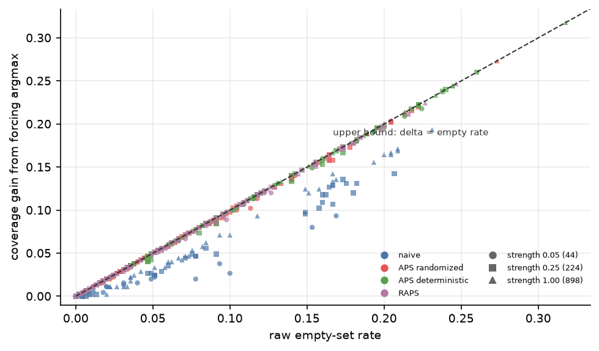
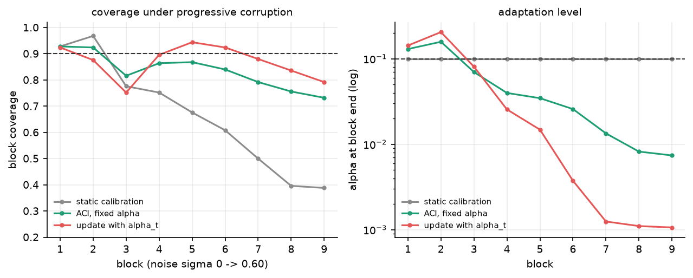
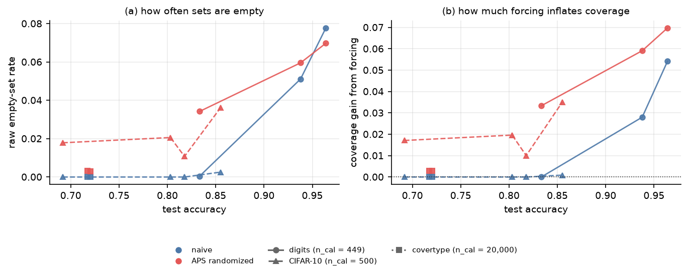

# What Does Conformal Prediction Add?
## A Controlled Audit of Calibrated Set-Valued Classification

::: {.author}
**Author:** [Name]  
**Affiliation:** [Institution]  
**Corresponding author:** [email]
:::

**Abstract.** A conformal predictor comes with a finite-sample coverage
guarantee. The number a pipeline reports does not. We audit three choices that sit
between the guarantee and the reported number: the calibration of the threshold,
the treatment of empty sets, and the update rule of adaptive conformal inference.
Across two image datasets, a tabular benchmark, and a range of model strengths, a fixed probability
threshold is not a coverage method, a threshold calibrated on the true-class
probability is exactly split conformal, and forcing the argmax into empty sets
raises the reported coverage by up to 9.7 points at α = 0.10 on the image
benchmarks. On a tabular benchmark the same mechanism is near zero, as the
empty-rate diagnostic predicts. The common α_t update is not ACI and reports higher coverage by
inflating sets. The audit of eight libraries
shows that the empty-set policy varies, that one widely used default over-covers
by 4.6 points, and that three ACI implementations use the correct fixed-target
update. We organise the field by guarantee and assumption rather than by
chronology, and we give a six-item checklist. The guarantee constrains the
procedure, not the number that the pipeline prints.

**Keywords.** conformal prediction; coverage; calibration; post-processing;
adaptive conformal inference; implementation audit.

---

## 1. Introduction

### 1.1 A number and a guarantee

A practitioner sets a 0.90 coverage target. The simplest way to meet it is to
threshold the softmax at 0.90, keep the labels above the threshold, and report the
fraction of test points on which the true label is in the set. The reported number
is usually close to the model's accuracy, and it is often presented as evidence
that the model is calibrated. It is not. The threshold is a fixed probability, not
a calibrated quantile, and the set it produces is a singleton or empty. The number
is a property of the threshold rule, not of the guarantee.

The conformal alternative replaces the fixed threshold with a quantile of the
calibration scores. The resulting set satisfies a finite-sample coverage guarantee
under exchangeability [38, 3]. The guarantee is real,
and it is the reason the method is worth using. The guarantee is also a statement
about the procedure, not about the number a particular pipeline prints. Between
the procedure and the number sit at least three choices: how the threshold is
calibrated, what the implementation does with an empty set, and how an adaptive
method updates its target. Each choice can move the reported coverage without
changing the guarantee. This paper is about those three choices.

### 1.2 Three places where the number moves

The first is the threshold. A fixed probability threshold is not a coverage
method. It returns a singleton for the labels above the threshold and an empty set
for the rest, and its coverage is the model's accuracy on the points it does not
abstain on. The correct calibration is a threshold on the true-class probability,
and that threshold is exactly split conformal with the naive score. The identity
is one line, and it is known [1]. We do not claim it. We measure what
follows from using the wrong threshold. On CIFAR-10, a raw 0.90 threshold returns
an empty set for 24.4 percent of the test points even when the model is 85.5
percent accurate, and a threshold calibrated on the maximum probability still
falls short of the target.

The second is the empty set. A conformal set can be empty, and many
implementations insert the argmax so that the output is never empty. The insertion
is a post-processing rule, and it changes the reported coverage by the empty rate
times the conditional accuracy of the argmax on the empty sets. At α = 0.10, the change reaches 9.7 points on
digits and 9.5 on CIFAR-10. The effect is not a property
of the score. It is a property of the interaction between the score and the
post-processing, and it can turn a method that is on target into one that
over-covers by several points.

The third is the update rule. Adaptive conformal inference moves the target level
after each observation. The published recursion uses a fixed target, and a common
implementation replaces it with the current level. The replacement removes the
restoring force toward the nominal level, and the wrong rule can report a higher
coverage by driving the level to the lower clip and inflating the sets. On
CIFAR-10 the wrong rule reports 10.8 more points of coverage than the correct one, at a 41 percent larger mean set size. The correct rule is not a cure-all. On the
streams we tested it also falls short of the target, for reasons that the current
theory does not separate.

The three choices are not independent. The first decides whether a comparison is
between two rules or between two calibrations. The second decides whether a
comparison is between two scores or between two post-processing rules. The third
decides whether an adaptive method is adapting or inflating. A paper that ignores
all three can report a number that is internally consistent and externally
meaningless.

### 1.3 What this paper does

We audit the three choices on two image datasets and a tabular benchmark. The
digits benchmark is small enough to check by hand. CIFAR-10 is large enough that
the coverage estimates are tight. Covertype is a tabular benchmark with seven
classes, used to test whether the post-processing effect survives a different
modality. We vary the score, the target level, the calibration size, and the model
strength, and we evaluate every cell twice, once with the empty sets kept and once
with the argmax forced. The image grid has 1,260 cells; the tabular replication
adds 180 rows. We also audit eight libraries, all at the source level and five at
runtime, and we compare their empty-set policies and their update rules.

The audit is organised by a two-axis map. The rows are the guarantee a method
pursues: marginal coverage, group-conditional coverage, pointwise conditional
coverage, and risk control. The columns are the assumption it is willing to make:
exchangeability, covariate shift, non-exchangeability, and known groups. The map
replaces the chronology that a survey usually imposes, and its empty cells are the
open problems of Section 7.

### 1.4 Contributions and positioning

The paper makes four contributions. First, the map, which makes the assumptions
explicit and the costs comparable. Second, the audit, which measures the three
choices across two image datasets and a tabular benchmark, and separates the raw from the forced evaluation. Third,
the library policy map, which shows that the empty-set policy varies, that one
widely used default over-covers by 4.6 points, and that three ACI implementations
use the correct fixed-target update. Fourth, a six-item checklist for
practitioners.

Four surveys are close enough to require positioning. Angelopoulos and Bates
[3] is a tutorial. It builds the reader's intuition for the
split construction and covers the pre-2022 literature. Fontana et al.
[18] is a unified review of the theory. Campos et al. [12]
organises the NLP literature by task, and Zhou et al. [39] organises the
field by data modality. None of them audits the implementation choices that this
paper measures. The closest 2025-2026 work is narrower. Aguru [1] proves
the binary threshold geometry that our first audit uses. Mehrtens et al.
[27] document a different set of pitfalls in medical imaging. Gauthier
et al. [19] treat empty sets as a low-coverage outcome. Al Bataineh
[2] uses empty sets as a drift alarm. Boman [11] benchmarks
score functions without measuring the post-processing. The audit complements these
papers rather than repeating them. Preprints are marked in the reference list, and
the software versions are listed there as well.

### 1.5 Scope

The paper is an audit, not a benchmark. The datasets are three, the models are linear
heads, and the drift is a synthetic ramp on digits and a corruption family on
CIFAR-10. The claims are about
mechanisms, not about the magnitudes that a deployment should expect. The
bibliography is a curated pool, not a systematic census; the cited subset is what the argument needs. The empty
cells of the map mean "no method in the reviewed set," not "no method can exist."
A reader who wants a positive result about adaptive inference will not find it
here. A reader who wants to know how the reported number can move without the
guarantee moving will.

The rest of the paper is organised as follows. Section 2 states the guarantee and
the finite-sample correction. Section 3 introduces the map. Section 4 audits the
three choices and the libraries. Section 5 describes the experiments. Section 6
gives the checklist. Section 7 states the open problems.

## 2. The guarantee in one page

### 2.1 Exchangeability and what the guarantee assumes

A conformal predictor is a procedure, not a model. It takes a fitted classifier f, a
calibration sample, and a target error rate α, and it returns a set C(x) for each input.
The only assumption is that the calibration pairs and the test pair are exchangeable.
Exchangeability means that the joint distribution is invariant under permutation of the
indices. It is weaker than independence and identical distribution. Every i.i.d. sample is
exchangeable, and so is any sample whose distribution is symmetric in the order of the
observations.

The assumption is easy to state and easy to violate. A calibration set drawn at random from
the same collection as the test set is exchangeable with it. A calibration set drawn from
last year's data and deployed against this year's data is not. A calibration set selected
because it contains the cases the model finds hard is not. A test stream whose distribution
changes after every observation is not. In each case the guarantee does not degrade
gracefully. The coverage on the deployment distribution can fall far below 1 − α while
every diagnostic computed on the calibration distribution looks correct. This is the
failure mode that Section 5.4 measures.

The guarantee is marginal in a second sense as well. It averages over the randomness of the
calibration sample and the test point. It does not say that a particular realized set
covers the particular test label. It says that the procedure covers with probability at
least 1 − α over repeated draws. A single calibration set can produce coverage below
1 − α, and the probability that it does is not zero. For a binary classifier, the
calibration-conditional coverage follows a Beta law, and the probability of a shortfall can
be computed exactly [1]. The practical consequence is that a single estimate of
0.8996 against a target of 0.90 is not evidence of a bug, and a single estimate of 0.946 is
not evidence of a better method. Both are draws from a procedure whose average is fixed.

### 2.2 Split conformal

Figure 1 shows the three stages and the three places where the reported number can
move. The construction is the split conformal predictor of Vovk et al. [38] and Shafer and Vovk [33]. Fit f on a training set. Pass a disjoint calibration set
of size n through f and compute a nonconformity score s_i = s(X_i, Y_i) for each
calibration pair, where a larger score means the pair is less consistent with the model.
Sort the scores and take the k-th smallest, with k = ceil((n + 1)(1 − α)). For a new input
x, the prediction set is the collection of labels y whose score does not exceed q.

The index k is the part that is most often implemented incorrectly. The naive choice
ceil(n(1 − α)) gives a threshold that is too small, and the resulting coverage is below the
nominal level by a term of order 1/n. The choice ceil((n + 1)(1 − α)) costs one effective
calibration sample and buys a guarantee that holds for every n, not only in the limit. With
continuous scores, the coverage is exactly k/(n + 1), which exceeds 1 − α by at most
1/(n + 1) [38, 24]. The correction is not cosmetic. It is the difference
between a procedure with a finite-sample guarantee and a procedure with an asymptotic one.

The guarantee is a lower bound, and the upper bound is also informative. At n = 100 and
α = 0.10 the coverage is 91/101 = 0.901. At n = 10 it is 10/11 = 0.909. The absolute
difference is small, but it is the difference between a guarantee that is tight at the
nominal level and one that is visibly conservative. The calibration size is therefore a
design variable, not a nuisance. Section 5 varies it explicitly.

### 2.3 Scores and efficiency

Once the quantile is fixed, the only design freedom is the score. For classification, the
simplest choice is s(x, y) = 1 − p_y(x), which yields the set of labels whose predicted
probability exceeds a threshold. This is the least-ambiguous classifier of Sadinle et al.
[32], and it is the score that split conformal reduces to when the threshold is
chosen on the calibration set. The score is global. A class that the model systematically
under-predicts is excluded more often than the nominal rate allows, and the marginal
coverage is restored only by compensation across classes.

Adaptive scores change the object being thresholded. The APS score accumulates probability
mass in descending order until the true label is reached, so the score depends on the rank
of the true label rather than on its absolute probability [31]. The randomization
in the score is what restores exact validity in the presence of ties. The regularized
variant adds a penalty on the number of labels in the set and shrinks large sets at a small
cost in coverage [6]. For regression, the analogous choice is the absolute residual,
and the conformalized quantile regression of Romano et al. [30] uses a locally
adaptive residual.

Efficiency has no distribution-free optimum. There is no score that is uniformly smallest
across distributions, and the achievable set size depends on the model and on the data. A
better model produces smaller sets, and a worse model produces larger ones, but neither
changes the validity of the procedure. This is why the efficiency literature is a sequence
of score designs rather than a sequence of theorems, and why the choice of score is an
empirical question. It is also why the score determines the empty-set behavior that Section
4.2 measures. A score that can place every label above the threshold produces empty sets. A
score that cannot produces sets that are never empty. The validity guarantee is silent on
which case obtains.

### 2.4 Marginal and conditional coverage

Marginal coverage averages over the covariate distribution. Conditional coverage would
require P(Y in C(X) | X = x) ≥ 1 − α for almost every x. The second statement is much
stronger, and it is not attainable without assumptions. Barber et al. [7] show
that no distribution-free procedure can guarantee pointwise conditional coverage with
non-trivial sets for all distributions. The intuition is that a finite calibration sample
contains finite information about any particular x, and a procedure that must be valid for
every distribution can always be confronted with a distribution that concentrates its mass
elsewhere. In classification, the only procedure that attains the target everywhere is the
trivial one that returns the entire label space.

The field's responses weaken the target rather than the impossibility. Group-conditional
coverage requires the guarantee to hold on average within each of a collection of groups.
When the groups are known in advance, Mondrian calibration attains it by calibrating
separately within each group [37]. The cost is a smaller effective calibration
sample per group and the requirement that the group label be available at test time. Local
weighting attains a smoother version of the target by assuming that the conditional
coverage function varies slowly in x, and randomization makes the local weights
identifiable [22]. The assumption is explicit, and it is not verifiable from data
alone.

Class-conditional coverage is a group-conditional target, not a pointwise one. A
class-conditional coverage below the nominal level for the worst-served class is a
statement about a known group, and it is attainable with Mondrian calibration. It is not
evidence for or against the pointwise impossibility of Barber et al. Treating the two as
the same is a category error. The distinction matters for Section 5, where the
class-conditional deviations are large while the marginal coverage is nominal.

### 2.5 What the guarantee does not say

The guarantee does not say that the set is small. It does not say that coverage holds for
every subgroup. It does not say that the calibration set is representative of the deployment
distribution. It does not survive non-exchangeability without modification. It is a
statement about a procedure, not about a particular realized set, and it is a lower bound on
an average, not a promise about the next prediction.

These limits are not defects of the theory. They are the terms of the contract. The rest of
the paper is about what happens when the terms are forgotten. A reported coverage number is
the output of a pipeline that includes a score, a calibration set, a threshold rule, and a
post-processing rule. The guarantee constrains one of those objects. It does not constrain
the number that the pipeline prints.

## 3. A two-axis map

### 3.1 Why a map, not a chronology

A chronological account of conformal prediction is easy to write and hard to use. The field
did not develop in phases. The split construction, the adaptive score, the impossibility
result, and the risk-control extension were motivated by different problems, and several of
them overlap in time. A reader who memorizes the chronology learns a list of methods. A
reader who follows the guarantee learns where each method breaks.

The map in Table 1 has two axes. The rows are the guarantee a method pursues: marginal
coverage, group-conditional coverage, pointwise conditional coverage, and risk control. The
columns are the assumption it is willing to make: exchangeability, covariate shift,
non-exchangeability, and known groups. A method is located by the pair. A method that
claims a guarantee outside its column is mis-specified, and a method that is valid in one
column need not be valid in another.

The axes are not independent. Moving right weakens the data assumption. Moving down
strengthens the guarantee. The two directions compete: a stronger guarantee usually requires a stronger assumption, a larger set, or both. The empty cells are where the competition has not been resolved.

### 3.2 The rows

The first row is marginal coverage. The guarantee is P(Y in C(X)) ≥ 1 − α, averaged over the data distribution. It is the base case, and it is the only case that is attainable
without assumptions beyond exchangeability. The split construction of Vovk et al.
[38], the regression analysis of Lei et al. [24], and the tutorial of
Angelopoulos and Bates [3] all live here. The cost is one calibration
pass, and the score is free. The guarantee is weak in the sense that it says nothing about
any particular x. It is strong in the sense that it survives a badly misspecified model.

The second row is group-conditional coverage. The guarantee is that coverage holds on
average within each of a collection of groups. When the groups are known in advance,
Mondrian calibration attains it by calibrating separately within each group [37].
Gibbs et al. [21] develop a framework for group-conditional coverage under weaker
assumptions, and the cost is the same in kind: a smaller effective calibration sample per
group, and the requirement that the group label be available at test time. The guarantee is
stronger than marginal coverage and weaker than pointwise coverage. It is the right target
when the deployment has a known partition, such as a demographic group or a class label.

The third row is pointwise conditional coverage. The guarantee is P(Y in C(X) | X = x) ≥
1 − α for almost every x. Barber et al. [7] show that no distribution-free
procedure can attain it with non-trivial sets for all distributions. The constructive route
adds assumptions. Hore and Barber [22] assume that the conditional coverage function
varies slowly in x, and they show that randomization makes the local weights identifiable.
The assumption is explicit, and it is not verifiable from data alone. The sets are larger
than the marginal ones, and the guarantee is conditional only up to the smoothness
constant.

The fourth row is risk control. The guarantee is E[L(C(X), Y)] ≤ r for a bounded loss L, of
which coverage is a special case. Bates et al. [9] introduce the general
construction, and later work extends it to a grid of risk levels with multiplicity control
[4] and to a cross-validated version that removes the data-splitting loss [13]. The
assumption is a monotone loss and exchangeability. The cost is a grid search over the risk
level and a correction for the number of candidates. The guarantee is not a coverage
statement, and it does not reduce to one unless the loss is the indicator of a miss.

### 3.3 The columns

The first column is exchangeability. It is the base assumption, and every method in the first
column is valid under it. The column is not a statement about the data. It is a statement
about the procedure's tolerance. A calibration set drawn at random from the same
distribution as the test set satisfies it. A calibration set drawn from a different
distribution does not.

The second column is covariate shift. The guarantee is recovered by reweighting the
calibration scores according to the likelihood ratio between the test and calibration
covariate distributions [35]. The assumption is that the likelihood ratio is
known or estimable. When it is estimated, the estimation error propagates into the
guarantee, and the coverage is exact only if the ratio is exact. The column is therefore
narrower than it looks. It is not a distribution-free guarantee under arbitrary shift. It
is a guarantee under a shift that can be quantified.

The third column is non-exchangeability. The guarantee is weakened to a bound that depends
on a measure of the violation. Barber et al. [8] give a bound in terms of a
total-variation-like quantity, and Oliveira et al. [28] study the split
construction under a known ordering. The bound is exact, but the quantity is not estimable
from data in most applications. The alternative is online adaptation. Gibbs and Candès
[20] update the target level after each observation, and the guarantee becomes
an average over time rather than a statement about each step. The distinction matters. A
per-step guarantee is not available without assumptions. An average guarantee is, and it is
what the adaptive methods provide.

The fourth column is known groups. The method is Mondrian calibration, and the guarantee is
group-conditional [37]. The assumption is that the group label is known at
calibration and at test time. The cost is a smaller effective sample per group, and the
guarantee is only as good as the group definition. A group that is defined by a variable
the model can see is easy. A group that is defined by a variable the model cannot see is
not.

### 3.4 The empty cells

The map has empty cells, and they are the point. Pointwise conditional coverage under
covariate shift is empty in the reviewed set. Pointwise conditional coverage under
non-exchangeability is empty. Group-conditional coverage under covariate shift and under
non-exchangeability is empty. Risk control under covariate shift is empty in the reviewed
set. These are not claims that no method can exist. They are claims that no method in the
reviewed set occupies the cell, and they are the open problems of Section 7.

The empty cells also explain why the field's arguments often talk past each other. A method
that is valid in the exchangeable column can be presented as if it were valid under shift,
and a reader who does not check the column will believe it. The map makes the check
explicit. It is the first question a practitioner should ask of a new method. Which cell
does it occupy, and what does it assume to get there?

### 3.5 What the map buys

The map buys three things. First, it makes the assumptions explicit. A method's guarantee is
a conditional statement, and the condition is the column. Second, it makes the costs
comparable. A group-conditional guarantee costs a smaller effective sample. A pointwise
guarantee costs an unverifiable smoothness assumption. A risk-control guarantee costs a
grid and a multiplicity correction. Third, it makes the empirical audit interpretable. A
reported coverage number is a property of a cell, not of a score. The same score can
produce 0.90 in one cell and 0.95 in another, and the difference is the post-processing, not
the guarantee.

Table 9 places the map against four existing surveys. The comparison is about coverage, not
quality. The map's contribution is the two-axis organization and the explicit empty cells.
The empirical contribution is the audit of whether the reported numbers respect the cell.
Neither is a substitute for the other.

## 4. Three implementation traps

### 4.1 A calibrated threshold is split conformal

The simplest baseline for a coverage target is a probability threshold. Choose
t = 1 − α, keep the labels whose predicted probability exceeds t, and report the
empirical coverage on a test set. The procedure is one line of code, it is
available in every classifier, and it is not a coverage method. The audit in this
section shows why, and it shows that the correct version of the baseline is
exactly split conformal.

The identity is one line. For the naive score s(x, y) = 1 − p_y(x), the conformal
set is {y : 1 − p_y(x) ≤ q} = {y : p_y(x) ≥ 1 − q}, where q is the k-th smallest
calibration score. The right-hand side is a threshold rule with t = 1 − q. The conformal quantile is the (1 − α) quantile of 1 − p_true, so 1 − q is the corresponding quantile of the true-class probability, and the calibrated threshold is the same object. The set
construction is not doing any work beyond the calibration of the threshold. This
is a known consequence of the score definition, and for binary classifiers the
threshold geometry has been stated explicitly [1]. In multi-class
classification it is an immediate corollary of the probabilities summing to one.
We do not claim the identity. We measure what follows from ignoring it.

The measurement uses four rules at α = 0.10. The raw threshold fixes t = 0.90. The
max-probability rule chooses t as the α-quantile of the maximum predicted
probability on the calibration set. The true-class rule chooses t as the
α-quantile of the true-class probability. The conformal rule uses t = 1 − q. The
first is the baseline a practitioner writes. The second is the repair a careful
practitioner tries. The third is the correct calibration. The fourth is split
conformal.

Table 2 reports the digits results at n_cal = 449, and Table 5 reports CIFAR-10 at
n_cal = 2000, across four training-set sizes. Three facts are stable across the two image datasets.

First, the raw threshold is degenerate. At α = 0.10 and a training set of 44
digits, the raw threshold returns an empty set for 70.1 percent of the test
points, and its coverage is 0.294. Forcing the argmax into the empty sets raises
the coverage to 0.833, which is the model's accuracy. On CIFAR-10 with 30,000
training images and 85.5 percent accuracy, the raw threshold still returns an
empty set for 24.4 percent of the test points, and forcing the argmax raises the
coverage from 0.716 to 0.855. The pattern is the same at every strength. The raw
threshold is not a weak coverage method. It is a singleton rule with an
abstention region, and its coverage is the accuracy of the model on the points it
does not abstain on.

Second, the max-probability calibration is closer but not exact. On CIFAR-10 the
coverage is 0.668, 0.762, 0.771, and 0.810 at the four strengths. On digits it is
0.800, 0.886, and 0.901. It is close to the target only when the model is accurate
enough that the argmax is almost always the true class. The rule calibrates the
wrong quantity. The threshold should be chosen on the true-class probability,
because that is the event the coverage statement is about. Calibrating the
maximum probability answers a different question, and the answer is right only
when the two probabilities coincide.

Third, the true-class calibration and split conformal are the same rule. The
pointwise set comparison has zero mismatches on 450 test points times five seeds
times three strengths for digits, and on 10,000 test points times five seeds times
four strengths for CIFAR-10. The two rows in Table 2 and Table 5 are not
approximately equal. They are equal. The equivalence is the empirical form of the
identity, and it is the reason the correct baseline for a threshold comparison is
split conformal.

The practical consequence is a change in what a baseline is. A paper that
compares conformal prediction to a raw 0.90 threshold is comparing a calibrated
rule to an uncalibrated one, and the comparison is guaranteed to favor conformal
for a reason that has nothing to do with set construction. A paper that compares
conformal to a threshold calibrated on the true-class probability is comparing
two implementations of the same rule, and the comparison should find no
difference. The interesting comparison is the third one: conformal against a
different score, or against a different calibration set, or against a different
post-processing rule. The first two comparisons are already decided by the
algebra.

Figure 2 plots the coverage and the mean set size for the six rules at the three
digits strengths. The raw threshold sits at the accuracy floor, the
max-probability rule sits between the floor and the target, and the true-class,
conformal, and threshold-at-1−q rules sit on top of each other. The figure is a
visual proof of the identity, and it is the first thing a reader should look at
before reading the rest of the section.

The identity is not a criticism of conformal prediction. It is a clarification of
what the method adds. The method adds the calibration of the threshold, not the
shape of the set. Once the threshold is calibrated, the set is determined by the
score. Section 4.2 is about what happens when the score produces an empty set and
the implementation fills it.

### 4.2 Non-empty post-processing inflates coverage

A conformal set can be empty. The construction does not forbid it. If the score of
every label exceeds the threshold, the set has no elements. Some implementations
leave the empty set as it is, and some insert the argmax so that the output is
never empty. The choice is usually presented as a convenience. It is a
post-processing rule, and it changes the coverage of the procedure. This section
measures the change.

The accounting is exact. Let E be the set of test points whose raw set is empty,
and let a_E be the fraction of those points on which the argmax is correct.
Forcing the argmax adds one covered point for each point in E on which the argmax
is correct, and no coverage for the others. The change in coverage is therefore
|E|/N times a_E, which is the empty rate times the conditional accuracy of the
argmax on the empty sets. Write it as Δ = e a_E, with e = |E|/N. The identity is not an approximation. It is the
definition of the two quantities.

The experiment varies the score, the target level, the calibration size, and the
model strength. On digits the grid has 540 cells, 4 scores times 3 levels times 3
calibration sizes times 3 strengths times 5 seeds. On CIFAR-10 it has 720 cells,
with 4 strengths instead of 3. Every cell is evaluated twice, once with the empty
sets kept and once with the argmax forced. The full results are in Table 3 and
Table 6, and Figure 3 plots the change against the empty rate.

Across the 540 digits cells the mean change is 0.077 and the largest is 0.318. The
mean is 0.041 for the naive score, 0.080 for randomized APS, 0.108 for
deterministic APS, and 0.078 for RAPS. The ranking is the ranking of the empty
rates. The naive score produces few empty sets because its threshold is low. The
deterministic APS produces many because its cumulative score can exceed the
threshold for every label. On CIFAR-10 the naive score produces no empty sets at
any strength, and the change is zero. The randomized APS produces 1.0 to 3.7
percent empty sets and changes coverage by 0.9 to 3.6 points. The deterministic
APS produces 6.9 to 9.5 percent empty sets and changes coverage by 6.8 to 9.5
points.

The change is not confined to weak models. On CIFAR-10 with 100 training images, deterministic APS goes from 0.904 to 0.972, a change of 6.8 points. With 1,000 images it goes from 0.902 to 0.993, a change of 9.1 points. At
30,000 images it goes from 0.899 to 0.994, a change of 9.5 points. On digits the
largest cell is 9.7 points at 224 training points. The change does not shrink with
model strength, because the empty rate does not shrink. The naive
score is the exception: it produces no empty sets on CIFAR-10 at any strength, and
the change is zero. The naive score on digits at full strength produces 7.8
percent empty sets and changes coverage by 5.4 points. The empty rate is a
property of the score and the calibration, not of the model alone.

The 5,000-image CIFAR-10 cell is the exception that proves the rule.
Deterministic APS reaches 0.994 coverage with a mean set size of 6.08 and no empty
sets. The score is already conservative, so the fallback has nothing to do. The
cell is a reminder that there are two ways to over-cover: a non-empty rule, and a
score that is too conservative. The audit isolates the first, but a reader who
only looks at the coverage cannot tell them apart.

Figure 3 plots the change against the empty rate for all 1,260 cells. The points
lie just below the identity line, and the distance from the line is the
conditional accuracy of the argmax on the empty sets. The naive points are
furthest below, because the argmax is less often correct when the naive set is
empty. The APS points are close to the line, because the argmax is often correct
when the APS set is empty. The figure is the visual form of the accounting
identity, and it is the reason the change is predictable from the empty rate
alone.

The result has a direct consequence for the library audit in Section 4.4. MAPIE's
default APS reaches 0.9457 with zero empty sets. The randomized setting reaches
0.8998. The 4.6-point gap is the non-empty rule, not the score. The corrected
conclusion is that the default is not the exact conformal rule, and the coverage
it reports is the coverage of the post-processing.

The recommendation is not to ban the fallback. An empty set is a valid output, and
a deployment may prefer a guess to an abstention. The recommendation is to report
both numbers and to compare methods at the same post-processing rule. A comparison
between a forced method and an unforced method is a comparison between two
procedures, not between two scores. Section 4.4 shows that the choice is exposed
in some libraries and hidden in others, and that the default in one widely used
library is the non-empty rule.

### 4.3 The alpha_t update is not ACI

Adaptive conformal inference replaces the fixed target with an online update.
After each observation, the procedure observes whether the set covered the true
label, and it moves the target level in the direction that would have corrected
the error. The update in Gibbs and Candès [20] is
α_{t+1} = α_t + γ(α − err_t), where err_t is one if the set missed and zero
otherwise, and α is the fixed nominal level. The rule is simple, and the fixed
target is the part that makes it work. The level moves toward the value at which
the long-run error rate is α.

A common implementation error replaces the fixed α with the current α_t. The
recursion becomes α_{t+1} = α_t + γ(α_t − err_t). The difference looks small, and
it is not. The correct rule has a fixed point at err = α. The incorrect rule has a
fixed point at err = α_t, and because the procedure is calibrated at every level,
that condition is satisfied, to first order, at every α_t. There is no restoring
force toward the nominal level. The rule has a positive feedback term. When the
set covers, α_t increases by γα_t, and when it misses, α_t decreases by
γ(1 − α_t). At α_t = 0.10 the downward step is nine times the upward step, so a
run of misses drives the level to the lower clip, where the sets are as large as
the calibration scores allow. The procedure then reports a high coverage because
the sets are large, not because the level tracked the target.

The experiment compares the two rules on controlled drift streams. On digits, the
stream has 450 points in nine blocks, with Gaussian noise increasing from 0 to
0.60. On CIFAR-10, it has 3,000 images in three blocks of 1,000, one block for each
severity, across five corruption types. The calibration set is clean in both cases. The digits grid varies the step size from 0.005 to 0.2, the update rule, and the seed; the CIFAR-10 grid uses a single step size, 0.02. Table 4 and Table 7 report the results, and Figure 4 plots the digits coverage and level trajectories for the linear schedule at γ = 0.02.

On digits, the static procedure covers 0.666 of the stream. The correct update at
γ = 0.02 covers 0.836 with a mean set size of 3.44. The incorrect update covers
0.869 with a mean set size of 4.58. The coverage gain is 3.3 points. The set-size
cost is 33 percent. The share of near-trivial sets, those containing at least nine
of the ten labels, rises from 10.8 to 24.4 percent. The final level is 0.0074 for
the correct rule and 0.0011 for the incorrect one, which is the lower clip. On CIFAR-10 with five corruption types and three severities, the static procedure covers 0.451. The correct update covers 0.828 with a mean size of 4.93. The incorrect update covers 0.936 with a mean size of 6.97. The coverage gain is 10.8 points, the set-size cost is 41 percent, and the near-trivial share rises from 14.5 to 38.0 percent. In both image streams the incorrect
rule wins the coverage comparison and loses the information comparison.

The correct rule also fails to reach 0.90 on these streams. On digits it reaches
0.836 with the level at 0.0074. On CIFAR-10 it reaches 0.828 with the level at 0.0106. The failure is not a bug in the update. It is the finite-time behavior
of the method. The calibration scores bound how far the quantile can move. Once
the level is at the clip, the set is the largest the calibration sample allows,
and a corrupted point can still fall outside it. The step size bounds how fast the
level can move, and a drift that is faster than the step size produces a transient
loss. The two mechanisms are visible in the block curves of Figure 4 for digits and in
Table 7 for CIFAR-10. The correct
rule tracks the target at the beginning of the stream and falls behind as the
corruption increases.

The incorrect rule is also unstable. At γ = 0.1 on the abrupt schedule, two of the five digits seeds drive the level above 0.69, one of them to 0.998, and coverage falls to 0.436 and 0.162. The seed standard deviation of coverage is 0.205 on the linear
schedule, against 0.046 for the correct rule at the same step size. The positive
feedback term can push the level to either clip, and the direction depends on the
sequence of errors. A method that reports a single coverage number and hides the
level trajectory can present a divergent run as a successful one.

The library audit in Section 4.4 changes the scope of this result. MAPIE, TorchCP,
and AdaptiveConformal all use the fixed-target update. The error is a risk of
hand-written implementations, not a default of the libraries we checked. The
audit's value is therefore narrower than "the ecosystem is wrong." It is that the
error is easy to make, it produces a plausible-looking improvement, and a coverage
report alone cannot detect it. The report needs the level trajectory, the clip
fraction, and the set-size distribution. Section 4.4 gives the library evidence,
and Section 6 turns it into a checklist.

### 4.4 Do real libraries do this?

The audit so far uses our own set constructor. A reader may ask whether the
behaviour is an artifact of that choice. We inspected eight implementations:
MAPIE 1.6.0, TorchCP 1.2.1, puncc 0.9.3, crepes 0.9.1, coverforest 0.0.3,
nonconformist 2.1.0, conformal 0.1, and the AdaptiveConformal R package. All
eight were read at the source level. MAPIE, puncc, crepes, nonconformist, and
conformal were also run on a common synthetic five-class problem; MAPIE was run
with five seeds, and the others with one.

The first finding is that the empty-set policy is a design choice, not a
universal. MAPIE's APS implementation defaults to include_last_label=True,
which adds the label that crosses the quantile and therefore never returns an
empty set. TorchCP returns the boolean mask scores <= q_hat. puncc returns
index lists. crepes returns p_values >= 1 - confidence. All three can return
empty sets. coverforest exposes the choice directly, with allow_empty_sets=True
as the default and documentation that recommends using False sparingly.
Table 8 summarises the eight implementations. It is a policy map, not a defect
list. The sample includes two older, smaller packages as well as the maintained
ones. It is a sample of public implementations, not a census.

The second finding is that MAPIE's default is a non-empty rule of a different
kind from the argmax fallback studied in Section 4.2. It does not insert the
argmax. It inserts the last label whose cumulative mass crosses the threshold.
The effect is nevertheless the same in kind. Over five seeds at alpha = 0.10,
the default reaches 0.9457 +/- 0.0107 with zero empty sets and a mean size of
3.676. The randomized setting, which is the exact conformal rule, reaches
0.8998 +/- 0.0105 with an empty rate of 0.0004 and a mean size of 3.232. The
False setting reaches 0.8284 +/- 0.0150, below the target. The two
non-randomized settings therefore err in opposite directions. The default
over-covers by 4.6 points; the exact rule lands on the target.

One more library reproduces the pattern. On the same one-seed task, puncc's APS
with randomization off reaches 0.977 with no empty sets. With randomization on it
reaches 0.889 with an empty rate below 0.2 percent. The switch is explicit in the API, and
the documentation says that turning randomization off avoids empty sets. The LAC
implementations of MAPIE, puncc, and crepes agree to three decimals (0.895, mean
size 2.87), which is a consistency check on the audit itself.

The MAPIE documentation acknowledges that True and False "may result in a
coverage higher than 1 - alpha", because neither creates empty sets. It does
not quantify the gap, and it does not say that the default differs from the
exact rule by enough to change a comparison between methods. That is the gap
this section fills.

This matters for how the result should be read. The phenomenon in Section 4.2
is not specific to our argmax fallback. Any non-empty rule changes the
coverage of the sets it produces, and the direction and size of the change
depend on the rule. The argmax fallback produces the identity derived in
Section 4.2, where the gain is the empty rate times the conditional accuracy
of the argmax. The MAPIE default produces a different accounting, but the same
qualitative outcome: coverage above the nominal level, larger sets, and a
reported number that belongs to the post-processing rather than to the
guarantee.

The third finding concerns the ACI update. MAPIE's time-series regressor
updates the level with a fixed target, alpha_t + gamma * (alpha_0 - error).
TorchCP does the same with a fixed alpha. The AdaptiveConformal R package
updates a quantile level against a fixed alpha. None of the three uses the
alpha_t recursion studied in Section 4.3. The error is therefore a risk of
hand-written implementations, not a default of the libraries we checked. That
narrows the claim of Section 4.3. The value of the audit is not that the
libraries are wrong. It is that the error is easy to make, produces a
plausible-looking improvement, and is invisible in a coverage report alone.

Two practical consequences follow. A user of MAPIE's default APS should report
0.946, not 0.90, and should say that the number comes from a non-empty rule. A
user who wants the exact guarantee should select the randomized setting, or
report both the unmodified sets and the non-empty version. More generally, a
coverage report is not interpretable without the set-construction rule that
produced it. The rule is part of the method, and it belongs in the methods
section.

The audit has limits. Five of the eight implementations were run. TorchCP,
coverforest, and AdaptiveConformal were read at the source level. coverforest
could not be run against scikit-learn 1.9, and TorchCP's optional graph
dependencies are not available on this machine.
The versions are those available on 2026-11-06, and line numbers will move.
The MAPIE experiment uses synthetic data, so the 4.6-point gap should be read
as an illustration of the mechanism rather than an estimate for a particular
application. The claim we defend is narrow: in the implementations we audited,
the non-empty policy varies, one widely used default over-covers by 4.6 points,
and the three ACI implementations we checked use the correct fixed-target
update.

<!-- cite: mapie2026, torchcp2026, puncc2026, crepes2026, coverforest2026, adaptiveconformal2023 -->

## 5. Experiments

### 5.1 Design

The experiments test three claims, not the accuracy of conformal prediction on a
benchmark. The first claim is that a probability threshold is a calibration rule,
and that the correct calibration is split conformal. The second is that non-empty
post-processing changes the coverage a pipeline reports. The third is that the
α_t update is not ACI. The design varies the quantities that should matter for
these claims: the score, the target level, the calibration size, the model
strength, and the dataset.

Three datasets are used: two image benchmarks and one tabular benchmark. The digits benchmark has 1,797 images of 8 by 8 pixels in
ten classes. A stratified split holds out 450 test points and 898 training points,
and the calibration set is drawn from the remaining 449. The model is a
standardiser followed by multinomial logistic regression. The training set is
subsampled to 5, 25, and 100 percent of the pool, which gives 44, 224, and 898
training points and a test accuracy that ranges from about 0.83 to 0.96. CIFAR-10
has 50,000 training images and 10,000 test images in ten classes. The images are
passed through a pretrained ResNet-18, and the 512-dimensional penultimate
features are used with a logistic-regression head. The training pool is 30,000
images, and the head is fitted on 100, 1,000, 5,000, or 30,000 of them, which
gives a test accuracy from 0.69 to 0.86. The calibration set is drawn from the
remaining 20,000, with sizes 500, 2,000, and 10,000. The official test set is used
unchanged. Covertype is a 581,012-row, 54-feature, seven-class tabular dataset from
the UCI repository [10]. We use a 120,000-row stratified subset, a
logistic regression, training sizes of 6,000 and 60,000, a calibration set of
20,000, and a test set of 40,000. The audit B grid is repeated on it.

The benchmarks are chosen for contrast, not for scale. Digits is small enough
that every number can be checked by hand, and CIFAR-10 is large enough that the
coverage estimates are tight. None is a deployment benchmark, and Section 5.6
is explicit about the limits.

Four scores are compared. The naive score is 1 − p_y. The randomized APS score
accumulates the probability mass of the classes ranked above the true class and
adds a uniform fraction of the true class's probability. The deterministic APS
score uses the cumulative mass through the true class and no randomization. The RAPS variant adds a penalty on the number of classes in the set, with λ = 0.01 and k_reg = 2 fixed rather than tuned.
The scores are implemented from the papers rather than imported from a library, so
the audit measures the method, not a library default. Section 4.4 audits the
libraries separately.

The post-processing is the variable that the audit turns on. Every cell is
evaluated twice. The raw evaluation keeps empty sets as empty. The forced
evaluation inserts the argmax into every empty set. The forced evaluation is a
measurement device, not a method. It answers the question "what would this
pipeline report if it forced a non-empty output?" The two evaluations share the
same sets, the same scores, and the same calibration. The only difference is the
post-processing.

The metrics are coverage, mean set size, empty rate, class-conditional coverage,
expected calibration error, and negative log-likelihood. Coverage and size are the
primary quantities. The empty rate is the mechanism behind the post-processing
result. The class-conditional coverage is reported because it is often confused
with pointwise conditional coverage; Section 2.4 explains the difference. The
calibration metrics are reported because the scores are built on probability
outputs, and a reader should be able to see whether the model is over- or
under-confident.

Every cell is repeated over five seeds, except the CIFAR-10 drift experiment,
which uses three. The digits confidence intervals are bootstrap intervals over
the test points; the CIFAR-10 intervals are normal approximations, which are tight
at 10,000 test points. The seeds change the split, the calibration draw, and the
model fit. The reported numbers are means over seeds, and the tables report the
standard deviation where it matters.

Table 10 summarises the grid. The full grid is larger than the tables. The digits
audit B has 540 cells and the CIFAR-10 audit B has 720. The tables report the
cells at α = 0.10, and the figures report the full range.

### 5.2 Audit A: the threshold is a calibration rule

Audit A compares four threshold rules at α = 0.10. The rules are the raw threshold
at 0.90, the max-probability quantile, the true-class quantile, and split
conformal. They are evaluated on digits with n_cal = 449 and on CIFAR-10 with
n_cal = 2,000, across the model strengths.

The result is a check, not a discovery. The true-class rule and split conformal
are identical pointwise. The raw threshold is degenerate. The max-probability rule
is between the two and is not exact. Table 2 and Table 5 give the numbers, Figure
2 plots them, and Section 4.1 reads the table. The purpose of the audit is to
establish the baseline for the next two. If the threshold is a calibration rule,
then the interesting comparison is between scores and between post-processing
rules, not between conformal and a raw threshold.

### 5.3 Audit B: the post-processing

Audit B varies the score, the target level, the calibration size, and the model
strength. On digits the grid has 540 cells. On CIFAR-10 it has 720. Each cell is
evaluated raw and forced, so the audit produces 1,080 and 1,440 rows. The full
results are in Table 3 and Table 6, and Figure 3 plots the change against the
empty rate.

The summary is in Section 4.2. Three features of the design are worth stating
here. First, the grid is balanced over the score and the calibration size, so the
ranking of the scores is not an artifact of one calibration size. Second, the
model strength is varied independently of the calibration size, because the
training pool and the calibration pool are disjoint and the calibration size is
drawn from a fixed pool. Third, the forced evaluation is applied to the same sets
as the raw evaluation, so the change is not confounded by a different threshold or
a different score.

The grid also produces the exception that Section 4.2 discusses. Deterministic APS
at 5,000 CIFAR-10 images is already conservative before the fallback, with a
coverage of 0.994 and a mean set size of 6.08. The fallback has nothing to do. The
cell is not a failure of the audit. It is a reminder that over-coverage can come
from the score as well as from the post-processing.

Table 11 repeats the audit on covertype. At alpha = 0.10 the empty rate is 0.0 to
0.4 percent, and the forcing change is 0.0 to 0.4 points. The identity holds; the
magnitude is governed by the empty rate. The trap is a regime effect, not a
universal constant: on a well-calibrated tabular model with seven classes, the
same post-processing is nearly invisible. The near-zero change is what the identity predicts when the empty rate is near
zero; it is a confirmation, not a null result. The empty rate is the diagnostic,
and it travels across datasets.

### 5.4 Audit C: the update rule

Audit C compares two update rules on controlled drift streams. The digits stream
has 450 points in nine blocks, with Gaussian noise increasing from 0 to 0.60.
Three schedules are used: linear, step, and abrupt. The CIFAR-10 stream has 3,000
images in three blocks of 1,000, one for each severity of a corruption type,
across five corruption types. The calibration set is clean in both cases, so the drift is a violation of exchangeability rather
than a corrupted calibration.

The digits grid varies the step size over six values from 0.005 to 0.2, the update
rule over two values, and the seed over five. The CIFAR-10 grid uses a single step
size, 0.02, five corruption types, and three seeds. The static procedure is included as a baseline. Table 4 and Table
7 report the results, and Figure 4 plots the coverage and the level trajectories
for the linear schedule at γ = 0.02.

The design separates the two questions that a coverage number confounds. The first
is whether the method adapts. The second is whether the adaptation is bought with
larger sets. The grid reports both, along with the level trajectory, the fraction
of steps at a clip bound, and the share of near-trivial sets. A reader who only
looks at the coverage cannot answer either question.

### 5.5 The regime map

The 1,260 image cells of audit B, plus the covertype replication, are the raw material
for a different view. Figure 5
plots the raw empty rate and the coverage gain against the test accuracy, at
α = 0.10 and a calibration size of 449 for digits, 500 for CIFAR-10, and 20,000
for covertype. Each point is a model strength, averaged over seeds. The figure
compares the naive score and the randomized APS. Covertype sits near the origin:
the empty rate is 0.0 to 0.4 percent, so the change is 0.0 to 0.4 points. The third
dataset is the low end of the diagnostic, not a counterexample to it.

The view is not a model-strength story. On digits the empty rate rises with
accuracy, from 0 to 7.8 percent for the naive score and from 3.4 to 7.0 percent for
APS. On CIFAR-10 the naive score is at zero at every strength, and APS is between
1.0 and 3.5 percent. The difference is the score and the calibration, not the
accuracy. A stronger model can have a higher empty rate if the score is more
likely to cross the threshold on every label. The figure makes the mechanism
visible and prevents the reader from reading the audit as a statement about weak
models.

The 5,000-image APS cell is the exception again. It is the only point where the
empty rate falls below the neighboring strengths, and it is the point where the
score is already conservative. The exception is a useful warning. The empty rate
is not a monotone function of accuracy, and a reader who expects a smooth curve
will misread the figure.

### 5.6 What the experiments do and do not show

The experiments show that the three mechanisms are real and that they are
reproducible in direction across three datasets and a range of model strengths,
though the magnitudes vary with the empty rate. They also show that on digits and
CIFAR-10 the magnitudes are large enough to change a comparison. The raw threshold can turn 70
percent of a test set into abstentions and then report the model's accuracy. At α = 0.10, the
post-processing can add 9.7 points of coverage on digits and 9.5 points on
CIFAR-10, with no change to the score. On covertype it adds 0.0 to 0.4 points, because the empty rate is 0.0 to 0.4 percent. The wrong update can add 10.8 points of coverage on CIFAR-10 while inflating the set size by 41 percent. On digits and CIFAR-10 these are not small effects, and they are not artifacts of
a single seed. On covertype they are small, and the empty rate explains why.

The experiments do not show that the traps are common across all libraries.
Section 4.4 shows the opposite for the update rule: three libraries use the
fixed-target update. They do not show that the magnitudes transfer to ImageNet, to
language models, or to a deployment with a different model class. The models are
linear heads on small images and a tabular benchmark; the drift is a synthetic
ramp on digits and a corruption family on CIFAR-10; the datasets are three. The results are about mechanisms, not about scale.

The experiments also do not establish that the correct ACI is a good method. On
the streams we tested it fails to reach the target, for reasons that Section 4.3
explains. A reader who wants a positive result about ACI will not find it here. A
reader who wants to know how the method fails, and how the failure can be mistaken
for success, will.

The code is a single script that fixes the seeds and writes every reported number
to a JSON file. The tables and figures are generated from that file. The data are
public, and the experiments can be rerun on a laptop. The reproducibility is not a
claim about the importance of the results. It is a condition for the reader to
check them.

## 6. A checklist for practitioners

The audit suggests a short checklist. None of the items is new. What is new is
how often they are omitted, and how much the reported number moves when they are.

1. Report the empty rate before any post-processing. The empty rate is the
mechanism behind the post-processing result. A forced coverage number without the
raw empty rate cannot be compared to an unforced one. Section 4.2 gives the
identity, and the empty rate is its first factor.

2. Calibrate the threshold on the true-class probability, not on the maximum
probability. The coverage statement is about the true label. The max-probability
rule is exact only when the argmax is always correct, which is a property of the
model, not of the procedure. Section 4.1 shows the gap on CIFAR-10, where the
max-probability rule reaches 0.810 at a target of 0.90.

3. State the update rule and the target it tracks. For adaptive conformal
inference, write the recursion and say whether the target is fixed. Section 4.3
shows that the two rules have different fixed points, and that the difference is
invisible in a coverage report.

4. Report the level trajectory, the clip fraction, and the set-size distribution.
Coverage alone cannot distinguish adaptation from inflation. The incorrect rule in
Section 4.3 reports higher coverage with larger sets, and the trajectory makes the
difference visible. A single number can present a divergent run as a success.

5. Match the post-processing rule before comparing methods. A forced method and
an unforced method are two procedures, not two scores. The comparison should hold
the post-processing fixed, and the empty rate should be reported for both.

6. Report the calibration size and the group definition. The finite-sample
coverage is k/(n + 1) with continuous scores, and the calibration-conditional
coverage is a random variable. A group-conditional claim is only as good as the
group definition, and class-conditional coverage is not pointwise coverage.

### 6.1 When to force the argmax

The checklist says to report both numbers. It does not say which one to use. The
choice is a decision under uncertainty, and it can be stated in one line.

Let c_a be the loss of abstaining on an empty set, and c_e the loss of a wrong
answer. A correct answer has loss zero. If the set is empty and the procedure
abstains, the loss is c_a. If it forces the argmax, the answer is correct with
probability a_E, where a_E is the conditional accuracy of the argmax on the empty
sets, and wrong with probability 1 - a_E. The expected loss of forcing is
c_e (1 - a_E). Forcing is better than abstaining exactly when

c_e (1 - a_E) < c_a.

The rule is a threshold on the ratio c_a/c_e. If abstaining costs as much as an
error, any positive a_E makes forcing worthwhile. If abstaining is free, forcing
is never worthwhile. If abstaining costs half an error, forcing is worthwhile
when a_E > 0.5. The audit does not choose the ratio. The deployment does.

The audit does supply a_E. The accounting identity of Section 4.2 gives
Δ = empty rate × a_E, so a_E is the ratio of the coverage gain to the empty rate.
A deployment that runs the audit on its own calibration and test data can estimate
a_E, plug in its costs, and decide. The six numbers of the checklist are the
inputs to the rule.

The library defaults are uniform versions of the decision, though not all of them
insert the argmax. MAPIE's include_last_label=True adds the last label that
crosses the quantile; puncc's rand=False adds labels until the set is non-empty.
Both are non-empty policies of the same kind, and the same cost comparison applies
with a_E replaced by the accuracy of the label the rule inserts. They are optimal
for a deployment whose c_a is high relative to c_e (1 - a_E), and suboptimal for a
deployment that values abstention. The library cannot know the ratio. This is why
the default should be the exact rule, which carries the guarantee, and the
non-empty rule should be an explicit option. coverforest exposes the option with
allow_empty_sets. MAPIE and puncc expose it through include_last_label and rand,
but their defaults choose the non-empty side. A default is a decision, and a
statistical library is not the place to make a deployment's decision.

The rule can also be applied per point, with the model's maximum probability as a
proxy for a_E. That version is a heuristic, not a guarantee. The conformal
construction does not give the conditional accuracy of the argmax on empty sets,
and the model's probability is not that quantity. The average rule is the one the
audit supports. The per-point rule is a heuristic, and on the three datasets we
tested it did not improve on the average rule (Section 6.2).

The conclusion is not that the fallback is wrong. It is that the fallback is a
decision, and the decision should be made with the costs in view. The audit's
contribution is to make the decision measurable. The empty rate, the conditional
accuracy, and the coverage and size costs are the quantities the decision needs.
The checklist reports them. The rule uses them.

### 6.2 A cost-sensitive reading

Table 12 applies the rule to the cells of audit B. For each cell with a non-zero
empty rate, a_E is estimated as the coverage gain divided by the empty rate, and
the threshold is 1 - a_E. The estimate is high in every dataset, between 0.94 and
0.99. The threshold is therefore small, between 0.01 and 0.06. Forcing is better
than abstaining unless abstention costs less than one to six percent of an error.

This explains why the non-empty defaults are popular. They are not a mistake in
every deployment. When the inserted label is right on most empty sets, forcing is
the better bet, and the default saves the deployment from an arbitrary abstention.
The problem is not that the bet is always wrong. The problem is that the bet is
made silently: the default changes the guarantee, and the reported coverage no
longer estimates the nominal level.

The empty rate determines the stakes. On digits, 6 to 9 percent of the points are
affected, so the choice moves the reported coverage by several points. On
covertype, 0.3 percent are affected, so the same choice moves it by less than half
a point. The threshold is small in every dataset; the exposure is not.

We also tested the per-point version. On the same three datasets, at alpha = 0.10
with deterministic APS, it coincides with uniform forcing at or above c_a/c_e = 0.05:
the empty sets are high-confidence, so the proxy forces them all. The per-point
rule does not improve on the population rule. The negative result is consistent
with the high a_E. When the argmax is right on 94 to 99 percent of the empty sets,
there is little for a per-point rule to select on.

The practical recommendation is therefore narrower than "never force". It is:
report the empty rate, report the conditional accuracy, and make the decision
explicit. A deployment that prefers a non-empty output can force, and the cost
analysis may justify it. A deployment that values abstention should not inherit
that choice from a default.

A paper that reports these six quantities can be checked. A paper that reports
only coverage cannot. The checklist is not a substitute for the theory. It is a
condition for the theory to be visible in the reported number.

## 7. Open problems

The map in Table 1 has empty cells. They are the open problems, and they are
stated here as measurable gaps rather than as declarations of impossibility. In
each case, the question is what would count as progress, not whether the problem
is hard.

### 7.1 Pointwise conditional coverage without exchangeability

The impossibility result of Barber et al. [7] is a statement about
exchangeable data. Under covariate shift or non-exchangeability, the target is
harder, and the map has no entry. Local weighting [22] obtains a
conditional guarantee up to a smoothness constant, and the bound under
non-exchangeability [8] is stated in terms of an unobservable distance. A
procedure that gives a pointwise guarantee under a quantifiable departure from
exchangeability, or a lower bound that shows the cost of the departure, would be
progress. A procedure that assumes the departure away is not progress.

### 7.2 Group-conditional coverage under shift

The group-conditional column is empty under covariate shift and under
non-exchangeability. The known-group case is solved by Mondrian calibration
[37], and the weaker group-level guarantee is developed by Gibbs et al.
[21]. The open case is the one in which the group label is missing at
test time, or the group distribution shifts with the covariates. A group-weighted
version of the covariate-shift correction [35] would be a natural
candidate, but the weight estimation error and the group sample size interact, and
the interaction is not understood. A bound on the group coverage under a known
shift, or a procedure that is robust to a misspecified group model, would be
progress.

### 7.3 Risk control under covariate shift

The risk-control row is empty under covariate shift in the reviewed set. The
exchangeable construction [9] and its grid and cross-validated variants
[4, 13] assume that the calibration and test distributions coincide. The natural extension is to weight the risk estimate by the likelihood ratio, but the weight estimation error enters the risk bound in a way that is not yet characterized, and the finite-sample correction for the weighted empirical risk is not settled. A risk bound that accounts for
the weight estimation error, or a procedure that remains valid under a
misspecified ratio, would be progress.

### 7.4 The finite-time behavior of adaptive inference

The correct update in Section 4.3 fails to reach the target on the streams we
tested, for two reasons that are not separated by the current theory. The
calibration support bounds how far the quantile can move, and the step size bounds
how fast it can move. A bound on the realized coverage as a function of the stream
length, the step size, and the calibration support would make the two mechanisms
separable. A step-size schedule that closes the gap, or a diagnostic that
distinguishes a support-limited failure from a step-limited one, would be
progress. The current practice of reporting a single average coverage number does
not distinguish them.

### 7.5 The prevalence and the utility of non-empty rules

Section 4.4 audits eight implementations. The policy map is a start, not a census.
A systematic audit of the defaults across the ecosystem, including the libraries
we did not run, would establish whether the MAPIE default is an outlier or a
pattern. The utility question is separate. The audit measures the cost of a
non-empty rule in coverage and set size, but it does not model the decision that
the rule supports. A deployment that prefers a guess to an abstention may be
better off with the fallback, and a deployment that acts on the set may be worse
off. A utility model that maps the empty rate and the conditional accuracy to a
decision, and an audit of the default policies against that model, would turn the
checklist into a design rule.

The empty cells are not a criticism of the field. They are the places where the
next paper can be useful. The audit's contribution is to make them visible, not to
fill them.

## Data and code availability

The experiments are implemented in a single Python repository with fixed seeds.
Every empirical number is written to a JSON file, and the tables and figures are
generated from those files. The digits benchmark is distributed with scikit-learn;
CIFAR-10 and covertype are public. README.md documents the environment, the data,
and the commands that regenerate Tables 2-7, 11 and 12 and Figures 1-5. Table 8's
source-policy columns are a curated reading of the code; its runtime rows come
from results/library_runtime.json. The repository is available at
https://github.com/ZhangShaoXuan-HIT/conformal-audit and archived at
https://doi.org/10.5281/zenodo.24001054.

## Tables

### Table 1. Guarantee by data assumption

Each cell gives a representative method, the assumption it needs, and the price it pays.
"Open" means no method in the reviewed set covers that cell. The empty cells are the
open problems of Section 7, not gaps in the table.

| guarantee | exchangeable | covariate shift | non-exchangeable / temporal | known groups |
|---|---|---|---|---|
| marginal coverage | [38], [24], [3]. One calibration pass. | [35]. Likelihood ratio known or estimable. | [8] (Barber et al. 2023), [28]. Gap bounded by the violation. | [37] (Mondrian). Per-group quantiles; small n per group. |
| group-conditional coverage | [37], [21]. Group-wise quantiles; smaller effective n. | open | open | [37], [21]. Group labels known at test. |
| pointwise conditional coverage | [7] (impossible without assumptions), [22] (local weights and smoothness). Larger sets. | open | open | open (implied by pointwise) |
| risk control | [9], [5] (Angelopoulos et al. 2022), [4] (Angelopoulos et al. 2025). Monotone loss; grid and multiplicity. | open in the reviewed set | [17] (Farinhas et al. 2023). Bounded non-exchangeability. | [14] (Macro Mondrian [5]). |

### Table 2. A calibrated threshold is split conformal

digits, alpha = 0.10, n_cal = 449, 5 seeds. Coverage is the mean over seeds.
Raw keeps empty sets; forced fills them with the argmax. Size is mean cardinality.
Pointwise set equality between the conformal threshold and split conformal: mismatches = 0.

#### strength = 0.05 (n_train = 44)

| method | coverage raw | coverage forced | size raw | size forced | empty raw |
|---|---|---|---|---|---|
| softmax threshold, raw t = 1-alpha | 0.294 | 0.833 | 0.299 | 1.000 | 0.701 |
| threshold at max-prob quantile | 0.800 | 0.837 | 0.920 | 1.006 | 0.086 |
| threshold at true-class quantile | 0.918 | 0.918 | 1.389 | 1.390 | 0.000 |
| threshold at t = 1-q (conformal) | 0.919 | 0.919 | 1.396 | 1.397 | 0.000 |
| split conformal, naive score | 0.919 | 0.919 | 1.396 | 1.397 | 0.000 |
| split conformal, APS | 0.917 | 0.952 | 1.886 | 1.922 | 0.036 |

#### strength = 0.25 (n_train = 224)

| method | coverage raw | coverage forced | size raw | size forced | empty raw |
|---|---|---|---|---|---|
| softmax threshold, raw t = 1-alpha | 0.713 | 0.938 | 0.719 | 1.000 | 0.281 |
| threshold at max-prob quantile | 0.886 | 0.938 | 0.912 | 1.000 | 0.088 |
| threshold at true-class quantile | 0.909 | 0.939 | 0.949 | 1.002 | 0.053 |
| threshold at t = 1-q (conformal) | 0.911 | 0.939 | 0.951 | 1.002 | 0.051 |
| split conformal, naive score | 0.911 | 0.939 | 0.951 | 1.002 | 0.051 |
| split conformal, APS | 0.904 | 0.976 | 1.178 | 1.251 | 0.073 |

#### strength = 1.00 (n_train = 898)

| method | coverage raw | coverage forced | size raw | size forced | empty raw |
|---|---|---|---|---|---|
| softmax threshold, raw t = 1-alpha | 0.855 | 0.964 | 0.860 | 1.000 | 0.140 |
| threshold at max-prob quantile | 0.901 | 0.964 | 0.912 | 1.000 | 0.088 |
| threshold at true-class quantile | 0.908 | 0.964 | 0.920 | 1.000 | 0.080 |
| threshold at t = 1-q (conformal) | 0.910 | 0.964 | 0.922 | 1.000 | 0.078 |
| split conformal, naive score | 0.910 | 0.964 | 0.922 | 1.000 | 0.078 |
| split conformal, APS | 0.903 | 0.982 | 1.034 | 1.113 | 0.079 |

### Table 3. Non-empty post-processing inflates coverage

digits, alpha = 0.10, 5 seeds. Delta = forced coverage - raw coverage.
Raw empty is the share of sets that were empty before the argmax was forced in.

#### strength = 0.05 (n_train = 44)

| score | n_cal | coverage raw | coverage forced | delta | empty raw | size raw | size forced |
|---|---|---|---|---|---|---|---|
| naive | 100 | 0.932 | 0.932 | +0.000 | 0.000 | 1.565 | 1.565 |
| naive | 225 | 0.929 | 0.929 | +0.000 | 0.000 | 1.491 | 1.491 |
| naive | 449 | 0.919 | 0.919 | +0.000 | 0.000 | 1.396 | 1.397 |
| APS randomized | 100 | 0.914 | 0.954 | +0.040 | 0.040 | 1.983 | 2.024 |
| APS randomized | 225 | 0.918 | 0.952 | +0.033 | 0.034 | 1.864 | 1.898 |
| APS randomized | 449 | 0.920 | 0.954 | +0.033 | 0.034 | 1.922 | 1.956 |
| APS deterministic | 100 | 0.893 | 0.981 | +0.088 | 0.090 | 3.551 | 3.641 |
| APS deterministic | 225 | 0.899 | 0.984 | +0.085 | 0.086 | 3.619 | 3.705 |
| APS deterministic | 449 | 0.898 | 0.981 | +0.084 | 0.084 | 3.549 | 3.634 |
| RAPS | 100 | 0.922 | 0.952 | +0.030 | 0.031 | 1.941 | 1.972 |
| RAPS | 225 | 0.917 | 0.951 | +0.034 | 0.034 | 1.874 | 1.908 |
| RAPS | 449 | 0.911 | 0.945 | +0.034 | 0.034 | 1.781 | 1.816 |

#### strength = 0.25 (n_train = 224)

| score | n_cal | coverage raw | coverage forced | delta | empty raw | size raw | size forced |
|---|---|---|---|---|---|---|---|
| naive | 100 | 0.922 | 0.947 | +0.025 | 0.044 | 0.981 | 1.025 |
| naive | 225 | 0.912 | 0.941 | +0.029 | 0.050 | 0.956 | 1.007 |
| naive | 449 | 0.911 | 0.939 | +0.028 | 0.051 | 0.951 | 1.002 |
| APS randomized | 100 | 0.911 | 0.979 | +0.068 | 0.068 | 1.236 | 1.305 |
| APS randomized | 225 | 0.901 | 0.975 | +0.074 | 0.074 | 1.193 | 1.268 |
| APS randomized | 449 | 0.919 | 0.978 | +0.059 | 0.060 | 1.239 | 1.299 |
| APS deterministic | 100 | 0.892 | 0.995 | +0.104 | 0.105 | 3.220 | 3.325 |
| APS deterministic | 225 | 0.907 | 0.996 | +0.089 | 0.090 | 3.372 | 3.463 |
| APS deterministic | 449 | 0.898 | 0.995 | +0.097 | 0.099 | 3.266 | 3.364 |
| RAPS | 100 | 0.910 | 0.975 | +0.065 | 0.065 | 1.215 | 1.280 |
| RAPS | 225 | 0.894 | 0.973 | +0.080 | 0.080 | 1.186 | 1.266 |
| RAPS | 449 | 0.896 | 0.973 | +0.077 | 0.077 | 1.148 | 1.226 |

#### strength = 1.00 (n_train = 898)

| score | n_cal | coverage raw | coverage forced | delta | empty raw | size raw | size forced |
|---|---|---|---|---|---|---|---|
| naive | 100 | 0.929 | 0.964 | +0.035 | 0.056 | 0.944 | 1.000 |
| naive | 225 | 0.917 | 0.964 | +0.047 | 0.071 | 0.929 | 1.000 |
| naive | 449 | 0.910 | 0.964 | +0.054 | 0.078 | 0.922 | 1.000 |
| APS randomized | 100 | 0.903 | 0.984 | +0.081 | 0.081 | 1.049 | 1.130 |
| APS randomized | 225 | 0.899 | 0.981 | +0.082 | 0.082 | 1.044 | 1.126 |
| APS randomized | 449 | 0.913 | 0.983 | +0.070 | 0.070 | 1.068 | 1.137 |
| APS deterministic | 100 | 0.894 | 1.000 | +0.106 | 0.106 | 3.011 | 3.117 |
| APS deterministic | 225 | 0.908 | 1.000 | +0.092 | 0.092 | 3.127 | 3.218 |
| APS deterministic | 449 | 0.911 | 1.000 | +0.089 | 0.089 | 3.110 | 3.199 |
| RAPS | 100 | 0.900 | 0.982 | +0.081 | 0.082 | 1.028 | 1.110 |
| RAPS | 225 | 0.887 | 0.982 | +0.095 | 0.096 | 1.018 | 1.113 |
| RAPS | 449 | 0.884 | 0.980 | +0.096 | 0.096 | 1.001 | 1.098 |

### Table 4. The alpha_t update is not ACI

digits, alpha = 0.10, 5 seeds. Coverage and size are means over seeds.
Min/max block are computed on the seed-averaged block curve. Clip is the share of steps at a clip bound.

#### schedule = linear

| update | gamma | coverage | seed SD | size | min block | max block | alpha final | clip | sets >= 9 |
|---|---|---|---|---|---|---|---|---|---|
| static | — | 0.666 | 0.100 | 1.524 | 0.388 | 0.968 | 0.1000 | 0.000 | 0.000 |
| fixed | 0.005 | 0.832 | 0.023 | 3.371 | 0.776 | 0.948 | 0.0054 | 0.045 | 0.130 |
| fixed | 0.010 | 0.840 | 0.030 | 3.598 | 0.768 | 0.932 | 0.0064 | 0.071 | 0.139 |
| fixed | 0.020 | 0.836 | 0.038 | 3.444 | 0.732 | 0.928 | 0.0074 | 0.091 | 0.108 |
| fixed | 0.050 | 0.818 | 0.049 | 3.469 | 0.684 | 0.916 | 0.0090 | 0.132 | 0.105 |
| fixed | 0.100 | 0.804 | 0.046 | 3.182 | 0.668 | 0.908 | 0.0090 | 0.156 | 0.087 |
| fixed | 0.200 | 0.775 | 0.043 | 3.103 | 0.624 | 0.904 | 0.0170 | 0.203 | 0.098 |
| buggy | 0.005 | 0.849 | 0.025 | 3.773 | 0.784 | 0.940 | 0.0010 | 0.052 | 0.176 |
| buggy | 0.010 | 0.865 | 0.031 | 4.273 | 0.780 | 0.924 | 0.0010 | 0.061 | 0.216 |
| buggy | 0.020 | 0.869 | 0.036 | 4.580 | 0.752 | 0.944 | 0.0011 | 0.065 | 0.244 |
| buggy | 0.050 | 0.870 | 0.043 | 5.169 | 0.792 | 0.956 | 0.0012 | 0.070 | 0.297 |
| buggy | 0.100 | 0.781 | 0.205 | 4.868 | 0.668 | 0.868 | 0.0014 | 0.076 | 0.279 |
| buggy | 0.200 | 0.769 | 0.153 | 4.788 | 0.476 | 0.900 | 0.0019 | 0.091 | 0.260 |

#### schedule = step

| update | gamma | coverage | seed SD | size | min block | max block | alpha final | clip | sets >= 9 |
|---|---|---|---|---|---|---|---|---|---|
| static | — | 0.663 | 0.085 | 1.488 | 0.432 | 0.960 | 0.1000 | 0.000 | 0.000 |
| fixed | 0.005 | 0.830 | 0.024 | 3.358 | 0.576 | 0.948 | 0.0064 | 0.051 | 0.130 |
| fixed | 0.010 | 0.835 | 0.028 | 3.492 | 0.680 | 0.940 | 0.0102 | 0.077 | 0.132 |
| fixed | 0.020 | 0.828 | 0.039 | 3.349 | 0.732 | 0.928 | 0.0098 | 0.102 | 0.104 |
| fixed | 0.050 | 0.808 | 0.046 | 3.176 | 0.712 | 0.916 | 0.0120 | 0.138 | 0.088 |
| fixed | 0.100 | 0.790 | 0.047 | 3.013 | 0.684 | 0.916 | 0.0190 | 0.166 | 0.079 |
| fixed | 0.200 | 0.767 | 0.042 | 3.010 | 0.664 | 0.900 | 0.0170 | 0.208 | 0.084 |
| buggy | 0.005 | 0.836 | 0.028 | 3.575 | 0.564 | 0.944 | 0.0010 | 0.060 | 0.161 |
| buggy | 0.010 | 0.845 | 0.031 | 3.826 | 0.676 | 0.924 | 0.0011 | 0.072 | 0.178 |
| buggy | 0.020 | 0.839 | 0.040 | 3.928 | 0.712 | 0.924 | 0.0012 | 0.076 | 0.188 |
| buggy | 0.050 | 0.809 | 0.067 | 4.078 | 0.636 | 0.892 | 0.0016 | 0.078 | 0.202 |
| buggy | 0.100 | 0.748 | 0.183 | 4.042 | 0.620 | 0.852 | 0.0015 | 0.086 | 0.199 |
| buggy | 0.200 | 0.733 | 0.163 | 4.262 | 0.484 | 0.840 | 0.0024 | 0.092 | 0.214 |

#### schedule = abrupt

| update | gamma | coverage | seed SD | size | min block | max block | alpha final | clip | sets >= 9 |
|---|---|---|---|---|---|---|---|---|---|
| static | — | 0.739 | 0.042 | 1.453 | 0.360 | 0.960 | 0.1000 | 0.000 | 0.000 |
| fixed | 0.005 | 0.831 | 0.021 | 2.411 | 0.508 | 0.948 | 0.0054 | 0.040 | 0.070 |
| fixed | 0.010 | 0.840 | 0.023 | 2.574 | 0.608 | 0.940 | 0.0064 | 0.061 | 0.073 |
| fixed | 0.020 | 0.836 | 0.029 | 2.499 | 0.640 | 0.928 | 0.0074 | 0.080 | 0.062 |
| fixed | 0.050 | 0.824 | 0.033 | 2.425 | 0.644 | 0.916 | 0.0090 | 0.103 | 0.052 |
| fixed | 0.100 | 0.816 | 0.030 | 2.398 | 0.620 | 0.916 | 0.0090 | 0.124 | 0.048 |
| fixed | 0.200 | 0.796 | 0.022 | 2.528 | 0.612 | 0.900 | 0.0170 | 0.167 | 0.061 |
| buggy | 0.005 | 0.828 | 0.024 | 2.448 | 0.492 | 0.944 | 0.0010 | 0.042 | 0.079 |
| buggy | 0.010 | 0.832 | 0.039 | 2.598 | 0.588 | 0.924 | 0.0010 | 0.052 | 0.085 |
| buggy | 0.020 | 0.807 | 0.065 | 2.580 | 0.564 | 0.924 | 0.0011 | 0.054 | 0.089 |
| buggy | 0.050 | 0.767 | 0.107 | 2.904 | 0.636 | 0.892 | 0.0012 | 0.062 | 0.115 |
| buggy | 0.100 | 0.628 | 0.320 | 2.500 | 0.492 | 0.852 | 0.3387 | 0.048 | 0.092 |
| buggy | 0.200 | 0.576 | 0.259 | 2.649 | 0.316 | 0.776 | 0.0019 | 0.066 | 0.122 |

### CIFAR-10, audit A: a calibrated threshold is split conformal

alpha = 0.10, n_cal = 2000, 5 seeds, 10k official test set.
Coverage is the mean over seeds. Raw keeps empty sets; forced fills them with the argmax.

| n_train | method | coverage raw | coverage forced | size raw | empty raw |
|---|---|---|---|---|---|
| 100 | raw threshold 0.90 | 0.290 | 0.692 | 0.310 | 0.690 |
| 100 | max-prob quantile | 0.668 | 0.702 | 0.921 | 0.103 |
| 100 | true-class quantile | 0.898 | 0.898 | 2.086 | 0.000 |
| 100 | t = 1-q | 0.898 | 0.898 | 2.090 | 0.000 |
| 100 | split conformal | 0.898 | 0.898 | 2.090 | 0.000 |
| 100 | APS | 0.896 | 0.911 | 2.471 | 0.016 |
| 100 | **accuracy** | **0.692** | | | |
| 1000 | raw threshold 0.90 | 0.647 | 0.803 | 0.705 | 0.295 |
| 1000 | max-prob quantile | 0.762 | 0.803 | 0.899 | 0.101 |
| 1000 | true-class quantile | 0.894 | 0.894 | 1.344 | 0.000 |
| 1000 | t = 1-q | 0.894 | 0.894 | 1.346 | 0.000 |
| 1000 | split conformal | 0.894 | 0.894 | 1.346 | 0.000 |
| 1000 | APS | 0.892 | 0.911 | 1.497 | 0.021 |
| 1000 | **accuracy** | **0.803** | | | |
| 5000 | raw threshold 0.90 | 0.731 | 0.818 | 0.819 | 0.181 |
| 5000 | max-prob quantile | 0.771 | 0.818 | 0.892 | 0.108 |
| 5000 | true-class quantile | 0.899 | 0.899 | 1.286 | 0.000 |
| 5000 | t = 1-q | 0.899 | 0.899 | 1.287 | 0.000 |
| 5000 | split conformal | 0.899 | 0.899 | 1.287 | 0.000 |
| 5000 | APS | 0.897 | 0.907 | 1.351 | 0.011 |
| 5000 | **accuracy** | **0.818** | | | |
| 30000 | raw threshold 0.90 | 0.716 | 0.855 | 0.756 | 0.244 |
| 30000 | max-prob quantile | 0.810 | 0.855 | 0.899 | 0.101 |
| 30000 | true-class quantile | 0.888 | 0.888 | 1.089 | 0.001 |
| 30000 | t = 1-q | 0.888 | 0.888 | 1.090 | 0.000 |
| 30000 | split conformal | 0.888 | 0.888 | 1.090 | 0.000 |
| 30000 | APS | 0.887 | 0.927 | 1.258 | 0.041 |
| 30000 | **accuracy** | **0.855** | | | |

### CIFAR-10, audit B: non-empty post-processing inflates coverage

alpha = 0.10, n_cal = 2000, 5 seeds, 10k official test set.
Delta = forced coverage - raw coverage. Raw empty is the share of empty sets.

| n_train | score | coverage raw | coverage forced | delta | empty raw | size raw | size forced |
|---|---|---|---|---|---|---|---|
| 100 | naive | 0.898 | 0.898 | +0.000 | 0.000 | 2.090 | 2.090 |
| 100 | APS randomized | 0.898 | 0.913 | +0.015 | 0.015 | 2.482 | 2.497 |
| 100 | APS deterministic | 0.904 | 0.972 | +0.068 | 0.069 | 4.437 | 4.506 |
| 100 | RAPS | 0.899 | 0.911 | +0.012 | 0.013 | 2.403 | 2.415 |
| 1000 | naive | 0.894 | 0.894 | +0.000 | 0.000 | 1.346 | 1.346 |
| 1000 | APS randomized | 0.896 | 0.914 | +0.018 | 0.019 | 1.515 | 1.534 |
| 1000 | APS deterministic | 0.902 | 0.993 | +0.091 | 0.091 | 4.654 | 4.745 |
| 1000 | RAPS | 0.897 | 0.913 | +0.016 | 0.016 | 1.490 | 1.506 |
| 5000 | naive | 0.899 | 0.899 | +0.000 | 0.000 | 1.287 | 1.287 |
| 5000 | APS randomized | 0.900 | 0.909 | +0.009 | 0.010 | 1.362 | 1.372 |
| 5000 | APS deterministic | 0.994 | 0.994 | +0.000 | 0.000 | 6.083 | 6.083 |
| 5000 | RAPS | 0.899 | 0.907 | +0.008 | 0.008 | 1.338 | 1.346 |
| 30000 | naive | 0.888 | 0.888 | +0.000 | 0.000 | 1.090 | 1.091 |
| 30000 | APS randomized | 0.893 | 0.930 | +0.036 | 0.037 | 1.271 | 1.309 |
| 30000 | APS deterministic | 0.899 | 0.994 | +0.095 | 0.095 | 3.967 | 4.061 |
| 30000 | RAPS | 0.894 | 0.929 | +0.035 | 0.036 | 1.261 | 1.297 |

### Table 7. CIFAR-10-C style drift

Five corruption types (gaussian_noise, defocus_blur, contrast, brightness,
jpeg_compression), three severities (1, 3, 5), 1,000 images per block, 3,000
points per stream, 3 seeds, alpha = 0.10, gamma = 0.02. Calibration is clean.

| update | coverage | mean size | block sev 1 | block sev 3 | block sev 5 | alpha final | clip | sets >= 9 |
|---|---|---|---|---|---|---|---|---|
| static | 0.451 | 1.30 | 0.588 | 0.457 | 0.308 | — | — | 0.000 |
| fixed | 0.828 | 4.93 | 0.853 | 0.829 | 0.802 | 0.0106 | 0.13 | 0.145 |
| buggy | 0.936 | 6.97 | 0.940 | 0.939 | 0.928 | 0.0019 | 0.05 | 0.380 |

#### Per corruption

Coverage and mean set size, averaged over three seeds.

| corruption | static | fixed | buggy |
|---|---|---|---|
| gaussian_noise | 0.22 / 1.34 | 0.66 / 5.45 | 0.81 / 7.02 |
| defocus_blur | 0.24 / 1.37 | 0.85 / 7.52 | 0.98 / 9.42 |
| contrast | 0.52 / 1.33 | 0.87 / 4.94 | 0.98 / 7.42 |
| brightness | 0.80 / 1.15 | 0.90 / 1.88 | 0.94 / 3.70 |
| jpeg_compression | 0.47 / 1.32 | 0.86 / 4.87 | 0.97 / 7.28 |

The incorrect update reports 10.8 points more coverage than the correct one, at a
41 percent larger mean set size, and raises the share of near-trivial sets from
14.5 to 38.0 percent. The correct update also falls short of 0.90, at 0.828.

### Table 8. Library behavior audit

Versions checked on 2026-11-06. Line numbers refer to the named files in the
package versions listed; the source snapshots were downloaded locally for the audit.
Runtime: MAPIE, puncc, crepes, nonconformist, and conformal. Source inspection:
TorchCP, coverforest, and AdaptiveConformal.

| library | version | task | empty sets possible | default policy | evidence | ACI update |
|---|---|---|---|---|---|---|
| MAPIE | 1.6.0 | classification | LAC yes; APS policy-dependent | APS default include_last_label=True: no empty sets, coverage 0.9457 vs 0.90 | classification.py:238-283; aps.py:355-358; lac.py:205-207; results/mapie_empty.json | fixed alpha_0 (time_series_regression.py:329) |
| TorchCP | 1.2.1 | classification | yes | no forcing; boolean mask (scores <= q_hat) | classification/predictor/base.py:111 | fixed alpha (regression/predictor/aci.py:197) |
| puncc | 0.9.3 | classification | yes | no forcing; index lists, empty when no class passes | api/prediction_sets.py:70-78, 112-119 | not implemented |
| crepes | 0.9.1 | classification | yes | no forcing; boolean mask (p_values >= 1-confidence) | base.py:340 | not implemented |
| nonconformist | 2.1.0 | classification | yes | no forcing; boolean matrix of p-values > significance; smoothing=True | icp.py:199-250 | not implemented |
| conformal | 0.1 | classification | yes (empty list possible) | no forcing; per-label thresholds at 100 - epsilon percentile | __init__.py:76-93, 95-108 | not implemented |
| coverforest | 0.0.3 | classification | yes by default | allow_empty_sets=True default; False avoids empty sets; docs warn to use it sparingly | _forest.py:1457, 2006-2008 | not applicable |
| AdaptiveConformal | GitHub main | regression intervals | not applicable | not applicable | R/aci_algorithm.R:78-81 | fixed alpha (correct) |

#### MAPIE 1.6.0, five seeds, alpha = 0.10

Synthetic five-class data, logistic regression, 2,000 test points per seed.
The correct randomised APS is the last row. The default is the second row.

| score | include_last_label | coverage (mean +/- SD) | empty rate | size |
|---|---|---|---|---|
| LAC | True | 0.9016 +/- 0.0080 | 0.0000 | 3.151 |
| APS, default | True | 0.9457 +/- 0.0107 | 0.0000 | 3.676 |
| APS | False | 0.8284 +/- 0.0150 | 0.0000 | 2.684 |
| APS, randomized | randomized | 0.8998 +/- 0.0105 | 0.0004 | 3.232 |

The default APS setting over-covers by 4.6 points with zero empty sets. The randomised
setting, which is the exact conformal rule, lands on the target. The difference is the
non-empty post-processing, not the score.

#### Runtime cross-check

Same synthetic five-class task for all libraries: 8,000 samples, logistic
regression, 2,000 test points, alpha = 0.10, test accuracy 0.487. One seed for every library in this table; the MAPIE numbers in the table above
use five seeds. The puncc randomized row has no fixed seed; its empty rate was
0.0 to 0.2 percent across runs.

| library | setting | coverage | empty rate | mean size |
|---|---|---|---|---|
| MAPIE | LAC | 0.895 | 0.000 | 2.87 |
| MAPIE | APS, include_last_label=True (default) | 0.949 | 0.000 | 3.46 |
| MAPIE | APS, include_last_label=False | 0.809 | 0.000 | 2.48 |
| MAPIE | APS, randomized | 0.892 | 0.001 | 3.02 |
| puncc | LAC | 0.895 | 0.000 | 2.87 |
| puncc | APS, rand=True | 0.889 | 0.000 | 2.99 |
| puncc | APS, rand=False | 0.977 | 0.000 | 4.06 |
| crepes | LAC (hinge), p >= alpha | 0.895 | 0.000 | 2.87 |
| nonconformist | ICP margin, smoothing=True | 0.890 | 0.000 | 3.50 |
| conformal | per-label thresholds, epsilon=10 | 0.890 | 0.000 | 3.02 |

coverforest 0.0.3 could not be run on scikit-learn 1.9: its forest code calls
_get_n_samples_bootstrap without the sample_weight argument that the installed
scikit-learn requires. TorchCP 1.2.1 was not run: its optional graph dependencies
(torch_geometric) are not installed. Both were read at the source level.

### Table 9. Coverage against four surveys

Authors' assessment of topical coverage, not of quality. A circle means the topic is not
a focus of that survey, not that the survey is deficient. Symbols: full circle =
comprehensive, half circle = partial, open circle = not a focus.

| dimension | this paper | Angelopoulos & Bates 2021 | Fontana et al. 2023 | Campos et al. 2024 | Zhou et al. 2025 |
|---|---|---|---|---|---|
| foundations | half | full | full | half | full |
| scores | full | full | half | full | full |
| conditional coverage | full | half | full | half | half |
| risk control | full | half | half | half | half |
| non-exchangeable | full | open | half | half | half |
| language models | half | open | open | full | half |
| implementation audit | full | open | open | open | open |
| two-dataset experiments | full | open | open | open | open |

The last two rows are the reason this paper exists. The first six rows are the reason it
has to cite the other four.

### Table 10. Experimental grid

| dataset | train pool | strengths | calibration | test | model | scores | alpha | seeds |
|---|---|---|---|---|---|---|---|---|
| digits | 898 | 44 / 224 / 898 | 449 for A and C; 100 / 225 / 449 for B | 450 | standardiser + logistic regression | naive, APS randomized, APS deterministic, RAPS | 0.10 for A and C; 0.05 / 0.10 / 0.20 for B | 5 |
| CIFAR-10 | 30,000 | 100 / 1,000 / 5,000 / 30,000 | 2,000 for A; 500 / 2,000 / 10,000 for B; 2,000 for C | 10,000 | ResNet-18 features + logistic regression | naive, APS randomized, APS deterministic, RAPS | 0.10 for A and C; 0.05 / 0.10 / 0.20 for B | 5 for A and B; 3 for C |
| covertype | 120,000-row subset | 6,000 / 60,000 | 20,000 | 40,000 | standardiser + logistic regression | naive, APS randomized, APS deterministic | 0.05 / 0.10 / 0.20 | 5 |

The calibration column gives the sizes used in each audit. The strength column gives
the number of training points used to fit the model; the calibration and test sets are
disjoint from it.

### Table 11. Covertype audit B

120,000-row stratified subset, 54 features, 7 classes, logistic regression,
20,000 calibration points, 40,000 test points, alpha = 0.10, 5 seeds.

| train | score | raw coverage | raw empty | raw size | forced coverage | forced size | delta |
|---|---|---|---|---|---|---|---|
| 6000 | naive | 0.900 | 0.000 | 1.53 | 0.900 | 1.53 | 0.000 |
| 6000 | APS randomized | 0.901 | 0.003 | 1.67 | 0.904 | 1.68 | 0.003 |
| 6000 | APS deterministic | 0.900 | 0.004 | 1.92 | 0.903 | 1.92 | 0.004 |
| 60000 | naive | 0.901 | 0.000 | 1.51 | 0.901 | 1.51 | 0.000 |
| 60000 | APS randomized | 0.900 | 0.003 | 1.65 | 0.903 | 1.66 | 0.003 |
| 60000 | APS deterministic | 0.899 | 0.001 | 1.89 | 0.900 | 1.89 | 0.001 |

The two training sizes give test accuracies of 0.717 and 0.721.

delta is forced coverage minus raw coverage. The identity delta = empty rate x
conditional accuracy holds. The empty rate is 0.0 to 0.4 percent, so the change is
0.0 to 0.4 points. The trap is a regime effect, not a universal constant.

### Table 12. Cost-sensitive reading of the fallback

At alpha = 0.10, over cells with a non-zero raw empty rate. a_E is the
conditional accuracy of the inserted label on empty sets, estimated as
delta / empty rate. The threshold is the cost ratio c_a / c_e above which
forcing is better than abstaining.

| dataset | score | cells | mean empty rate | mean a_E | threshold c_a/c_e |
|---|---|---|---|---|---|
| digits | aps_rand | 45 | 0.060 | 0.99 | 0.01 |
| digits | aps_det | 45 | 0.093 | 0.99 | 0.01 |
| cifar10 | aps_rand | 60 | 0.020 | 0.96 | 0.04 |
| cifar10 | aps_det | 45 | 0.084 | 0.99 | 0.01 |
| covertype | aps_rand | 10 | 0.003 | 0.94 | 0.06 |
| covertype | aps_det | 10 | 0.003 | 0.94 | 0.06 |

The threshold is small in every dataset (0.01 to 0.06); the empty rate is not.
The expected loss difference at a given cost ratio is proportional to the empty rate,
so the same rule matters much more on digits than on covertype.

## Figures

### Figure 1

### Figure 2

### Figure 3

### Figure 4

### Figure 5

## References

1. Aguru MK. What Split Conformal Prediction Guarantees, and What It Does Not: Exact Coverage Laws for Binary Classifiers, the Calibration-Set Size Needed for a Reliable Guarantee, and Class-Conditional Failure on UCI Adult. Zenodo (CERN European Organization for Nuclear Research), 2026. DOI 10.5281/zenodo.23582987. Preprint. 
2. Al Bataineh A. Certified Label-Free Drift Alarms From Empty Conformal Prediction Sets for Metal-Oxide Gas Sensor Arrays. IEEE Sensors Letters, 2026. DOI 10.1109/lsens.2026.3748815. 
3. Angelopoulos A N, Bates S. Conformal Prediction: A Gentle Introduction. Foundations and Trends in Machine Learning 16(4), 494-591, 2023. DOI 10.1561/2200000101. 
4. Angelopoulos A N, Bates S, Candès E J, Jordan M I, Lei L. Learn then Test: Calibrating Predictive Algorithms to Achieve Risk Control. Annals of Applied Statistics 19(2), 1641–1662, 2025. DOI 10.1214/24-AOAS1998. 
5. Angelopoulos A N, Bates S, Fisch A, Lei L, Schuster T. Conformal Risk Control. arXiv preprint, 2022. arXiv:2208.02814. Preprint. 
6. Angelopoulos A N, Bates S, Malik J, Jordan M I. Uncertainty Sets for Image Classifiers using Conformal Prediction. International Conference on Learning Representations (ICLR 2021), 2021. arXiv:2009.14193. 
7. Barber R F, Candès E J, Ramdas A, Tibshirani R J. The Limits of Distribution-Free Conditional Predictive Inference. Information and Inference 10(2), 455–482, 2021. DOI 10.1093/imaiai/iaaa017. 
8. Barber R F, Candès E J, Ramdas A, Tibshirani R J. Conformal Prediction Beyond Exchangeability. Annals of Statistics 51(2), 816–845, 2023. DOI 10.1214/23-AOS2276. 
9. Bates S, Angelopoulos A N, Lei L, Malik J, Jordan M I. Distribution-Free, Risk-Controlling Prediction Sets. Journal of the ACM 68(6), 1–34, 2021. DOI 10.1145/3478535. 
10. Blackard J A. Covertype. UCI Machine Learning Repository, 1998. DOI 10.24432/C50K5N. 
11. Boman SE. Benchmarking non-conformity score functions in conformal prediction. arXiv, 2026. arXiv:2605.24983. Preprint. 
12. Campos M M, Farinhas A, Zerva C, Figueiredo M A T, Martins A F T. Conformal Prediction for Natural Language Processing: A Survey. Transactions of the Association for Computational Linguistics 12, 1497-1516, 2024. DOI 10.1162/tacl_a_00715. 
13. Cohen K M, Park S, Simeone O, Shamai S S. Cross-Validation Conformal Risk Control. IEEE International Symposium on Information Theory (ISIT 2024), 250–255, 2024. DOI 10.1109/isit57864.2024.10619172. 
14. Combes J, Coeurjolly J, Derville A. Macro Mondrian Conformal Risk Control. arXiv preprint, 2026. DOI 10.48550/arxiv.2610.35035. Preprint. 
15. coverforest contributors. coverforest: conformal prediction with random forests. version 0.0.3, 2026. https://pypi.org/project/coverforest/. 
16. crepes contributors. crepes: conformal regressors and predictive systems. version 0.9.1, 2026. https://pypi.org/project/crepes/. 
17. Farinhas A, Zerva C, Ulmer D, Martins A F T. Non-Exchangeable Conformal Risk Control. arXiv preprint, 2023. arXiv:2310.01262. Preprint. 
18. Fontana M, Zeni G, Vantini S. Conformal prediction: A unified review of theory and new challenges. Bernoulli 29(1), 1-23, 2023. DOI 10.3150/21-BEJ1447. 
19. Gauthier E, Bach F, Jordan MI. Adaptive Coverage Policies in Conformal Prediction. arXiv preprint, 2025. DOI 10.48550/arxiv.2510.04318. Preprint. 
20. Gibbs I, Candès E J. Adaptive Conformal Inference Under Distribution Shift. Advances in Neural Information Processing Systems 34 (NeurIPS 2021), 2021. arXiv:2106.00170. 
21. Gibbs I, Cherian J J, Candès E J. Conformal Prediction with Conditional Guarantees. Journal of the Royal Statistical Society: Series B 87(4), 1100–1126, 2025. DOI 10.1093/jrsssb/qkaf008. 
22. Hore R, Barber R F. Conformal Prediction with Local Weights: Randomization Enables Robust Guarantees. Journal of the Royal Statistical Society: Series B 87(2), 549–578, 2025. DOI 10.1093/jrsssb/qkae103. 
23. Koul A. conformal: a minimal conformal prediction implementation for classification. version 0.1, 2017. https://pypi.org/project/conformal/. 
24. Lei J, G'Sell M, Rinaldo A, Tibshirani R J, Wasserman L. Distribution-Free Predictive Inference for Regression. Journal of the American Statistical Association 113(523), 1094–1111, 2018. DOI 10.1080/01621459.2017.1307116. 
25. Linusson H. nonconformist: Python implementation of the conformal prediction framework. version 2.1.0, 2017. https://github.com/donlnz/nonconformist. 
26. MAPIE contributors. MAPIE: a scikit-learn-contrib package for conformal prediction. version 1.6.0, 2026. https://pypi.org/project/mapie/. 
27. Mehrtens H, Bucher T, Brinker TJ. Pitfalls of Conformal Predictions for Medical Image Classification. arXiv, 2025. arXiv:2506.18162. Preprint. 
28. Oliveira RI, Orenstein P, Ramos TR, Romano JV. Split Conformal Prediction and Non-Exchangeable Data. arXiv preprint, 2022. DOI 10.48550/arxiv.2203.15885. Preprint. 
29. puncc contributors. puncc: predictive uncertainty calibration and conformal prediction. version 0.9.3, 2026. https://pypi.org/project/puncc/. 
30. Romano Y, Patterson E, Candes E J. Conformalized Quantile Regression. Advances in Neural Information Processing Systems 32 (NeurIPS 2019), 2019. arXiv:1905.03222. 
31. Romano Y, Sesia M, Candès E J. Classification with Valid and Adaptive Coverage. Advances in Neural Information Processing Systems 33 (NeurIPS 2020), 2020. arXiv:2006.02544. 
32. Sadinle M, Lei J, Wasserman L. Least Ambiguous Set-Valued Classifiers With Bounded Error Levels. Journal of the American Statistical Association 114(525), 223–234, 2019. DOI 10.1080/01621459.2017.1395341. 
33. Shafer G, Vovk V. A Tutorial on Conformal Prediction. Journal of Machine Learning Research 9, 371–421, 2008. DOI 10.5555/1390681.1390693. 
34. Susmann H, Chambaz A, Josse J. AdaptiveConformal: an R package for adaptive conformal inference. arXiv preprint, 2023. arXiv:2312.00448. Preprint. 
35. Tibshirani R J, Barber R F, Candès E J, Ramdas A. Conformal Prediction Under Covariate Shift. Advances in Neural Information Processing Systems 32 (NeurIPS 2019), 2019. arXiv:1904.06019. 
36. TorchCP contributors. TorchCP: a Python library for conformal prediction. version 1.2.1, 2026. https://pypi.org/project/torchcp/. 
37. Vovk V. Conditional validity of inductive conformal predictors. ACML 2012, PMLR 25, 475-490, 2012. https://proceedings.mlr.press/v25/vovk12.html. 
38. Vovk V, Gammerman A, Shafer G. Algorithmic Learning in a Random World. Springer, New York, 2005. DOI 10.1007/b106715. 
39. Zhou X, Chen B, Gui Y, Cheng L, Deng Z, Wang X, et al. Conformal Prediction: A Data Perspective. ACM Computing Surveys 58(2), 1–37, 2025. DOI 10.1145/3736575.
